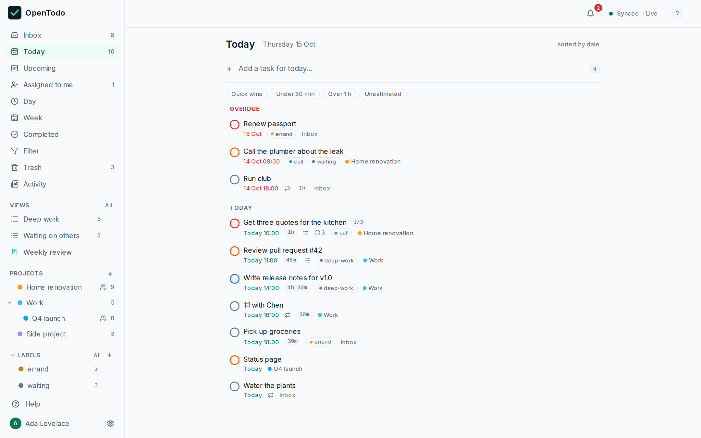
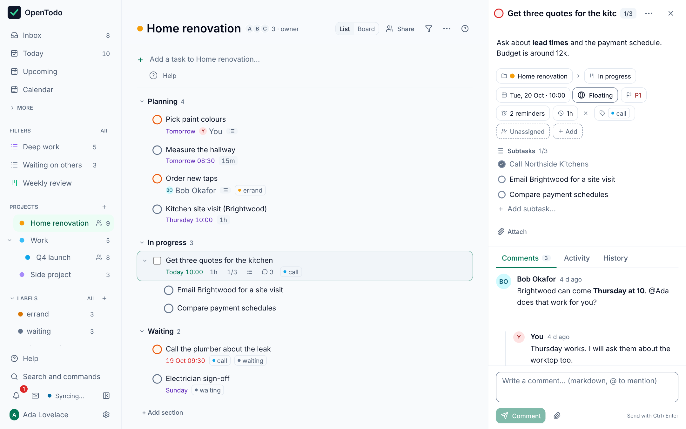
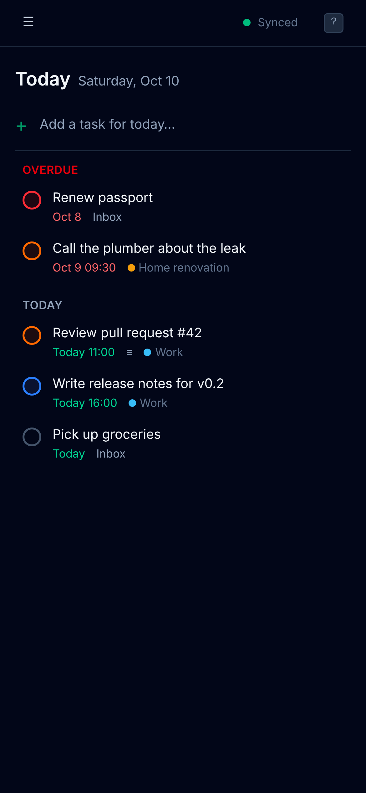
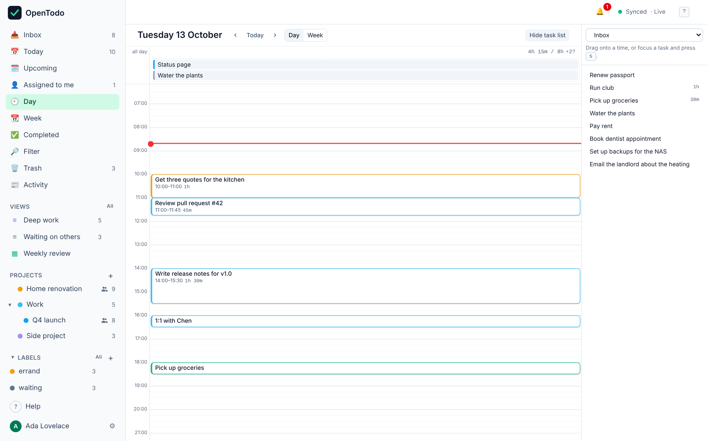

<p align="center">
  
</p>

<h1 align="center">OpenTodo</h1>

<p align="center"><strong>Your tasks, your server.</strong><br>
An open-source, local-first task manager you can host yourself. Everything you expect from a commercial task app, without the subscription or the lock-in.</p>

<p align="center">
  <a href="LICENSE"></a>
  <a href="https://github.com/pixari/opentodo/actions/workflows/ci.yml"></a>
  
  
</p>

<p align="center">
  <a href="docs/self-hosting/coolify.md">Deploy on Coolify</a> ·
  <a href="docs/self-hosting/docker.md">Docker</a> ·
  <a href="docs/api.md">API</a> ·
  <a href="docs/cli.md">CLI</a> ·
  <a href="docs/quick-add.md">Quick add syntax</a> ·
  <a href="docs/filters.md">Filters</a> ·
  <a href="docs/capture.md">Capture</a> ·
  <a href="ROADMAP.md">Roadmap</a> ·
  <a href="CONTRIBUTING.md">Contributing</a>
</p>

---

<p align="center">
  
</p>

<p align="center">
  
  
</p>

<p align="center">
  
</p>

## Why OpenTodo

- **No subscription, no lock-in.** Free software under the AGPL. Nobody can paywall your task list or shut it down with the company.
- **Local-first.** The app keeps a full copy of your data on every device and works entirely offline. The server only syncs, backs up and shares.
- **Your data, one folder.** Everything lives in a single `/data` volume: one SQLite file. Back that up and you have backed up everything. Export to JSON any time from Settings, and import it (or a CSV, or another app's export) on any instance.
- **Tiny footprint.** One container, one static binary, around 12 MB. Runs on a Raspberry Pi or the cheapest VPS. No database server, no Redis, no build step at runtime.
- **Private by design.** No telemetry, no analytics, no phone-home, no third-party scripts. The server only sends requests to webhook URLs you configure yourself and, for devices that enable notifications, end-to-end encrypted pushes to the push service their own browser chose (`OPENTODO_PUSH=off` turns that off). Sign-up is closed by default after the owner account is created; add people with single-use invitation links from **Settings → Members**.
- **Keyboard-first.** `q` to capture, `j`/`k` to move, `c` to complete, `1`–`4` for priority, `g` `t` for Today. Press `?` in the app for the full list.
- **Built in the open with specs.** Every feature starts as an [OpenSpec](https://github.com/Fission-AI/OpenSpec) change under [`openspec/`](openspec/), so behavior is documented before it is built.

OpenTodo belongs to the growing family of open-source, self-hostable replacements for subscription apps: a polished, modern app that gives you the comfort of a commercial product with software you run yourself.

## Features

**Today** (v0.1, the walking skeleton)

| Area | What works |
| --- | --- |
| Capture | Quick-add from any view, keyboard shortcut `q`; new tasks in Today get today's date, in a project get that project. Natural language in six languages, offline: `Call Sarah next Wed 3pm #work @call p1 +30m` sets the date, time, project, label, priority and estimate, with dismissible preview chips; see [docs/quick-add.md](docs/quick-add.md) |
| Share capture | Send pages to OpenTodo from the phone or desktop share sheet (installed app), a bookmarklet in Settings → Capture, or the browser extension in `extension/` (Chromium and Firefox): a capture screen prefilled with title, selected text and link, Enter to save into the Inbox or a project. Works offline, holds no token, see [docs/capture.md](docs/capture.md) |
| Organise | Projects with colours, Inbox, Today, Upcoming (grouped by day), Completed |
| Sharing | Share a project with other accounts on your server as viewer, editor or admin (`Shift+S` in a project): members edit offline and converge like your own devices, viewers see it read-only, admins and the owner manage members, ownership can be transferred, and leaving or being removed takes the project off every device. Roles are enforced by the server on sync and REST. See [docs/api.md](docs/api.md#sharing) and [docs/sync.md](docs/sync.md#sharing-scopes) |
| Assignees | Assign a task in a shared project to one member (detail panel or `Shift+A`, works offline); rows show the assignee, **Assigned to me** (`g a`) lists your open tasks across projects with a sidebar count, and the assignee gets an in-app notification. The server checks every assignment against the project's members and unassigns people who leave. See [docs/api.md](docs/api.md#assignment-and-notifications) |
| Labels | Cross-project labels with colours: `L` on a task opens a type-ahead picker that creates on Enter, chips on every row, a Labels group in the sidebar with live counts, one view per label grouped by project, rename / recolour / reorder / delete / merge duplicates |
| Filters | One-line queries such as `@work & due <= tomorrow & p1`: labels, projects (`##` includes sub-projects), priority, due and created dates, keywords like `overdue` or `no date`, text search, combined with `&`, `\|`, `!` and parentheses. Evaluated on the device, so results are live and work offline; `g` `f` opens the view, ↑ / ↓ recall recent queries. See [docs/filters.md](docs/filters.md) |
| Saved views | Save a filter with `s` as a named view that syncs: pinned to the sidebar with live counts, grouping (project, due date, priority, label) and sort options, editable query, `g` `v` overview, a start view per device, and dashboards of up to six views side by side. REST `/api/v1/views`. See [docs/filters.md](docs/filters.md#saving-views) |
| Sub-projects | Nest projects to any depth; collapsible sidebar tree (Left / Right, remembered per device) with rolled-up counts; "Move to" from the project menu or `m`; a project view lists its sub-projects; archiving cascades, deleting moves sub-projects up a level; concurrent moves on two devices never leave a project nested inside itself |
| Tasks | Title, notes, project, priority P1–P4, floating due date with optional time, complete / reopen, delete |
| Trash and history | Deleted tasks and projects go to the **Trash** (`g` `x`) and can be restored, offline too; a deleted project keeps its tasks and brings them back on restore. Every task and project has a **History** of its changes from the sync log (which device, when, old and new value) with "restore this value". Permanent deletion really removes the data from the server, for one item or the whole Trash, and devices drop their copy on the next sync; the server empties items older than 30 days (`OPENTODO_TRASH_RETENTION_DAYS`). Projects whose tasks are all done are offered for archiving and archived automatically after 30 days (opt out per device). See [docs/sync.md](docs/sync.md#purge) |
| Time blocking | Duration estimates (`e` on a task: `20`, `45m`, `1h30`, or presets) shown on every row, and **Day** / **Week** calendars (`g` `d`, `g` `w`) with a 15-minute grid: a task with a due time is a block as long as its estimate, date-only tasks wait in the day's unscheduled lane, overlapping blocks sit side by side, each day shows planned hours against your day length. Drag from the lane, the task list beside the grid or the grid itself; drag a block's lower edge to change the estimate; or do all of it from the keyboard (`s` on a list task opens placement mode, arrows move, Shift+arrows resize). Duration filter chips (Quick wins, Under 30 min, Over 1 h, Unestimated) in Inbox, Today, Upcoming and projects. Works offline; moves converge like any other edit |
| Recurring tasks | Rules you type and read: `every weekday`, `every last weekday`, `every 2nd tuesday`, `every 3 days after completion`, optionally `until 2026-12-31` or `for 10 times`. Completing records the occurrence in Completed and moves the task to its next date (overdue tasks catch up instead of piling up); skip (`Shift+S`) or detach one occurrence (`Shift+O`); a live preview of the next three dates. Two devices completing the same occurrence offline end with one entry. See [docs/recurrence.md](docs/recurrence.md) |
| Reminders | Any number per task: "30 minutes before" (follows the due date, also to the next occurrence of a recurring task) or at a set date and time, on undated tasks too. In-app notifications with Snooze (10 min, 1 h, tomorrow 09:00) and Dismiss that work offline; per-device web push in **Settings → Notifications** so a closed app still notifies, with no vendor account and no configuration (payloads carry ids only unless you opt in to titles). See [docs/reminders.md](docs/reminders.md) |
| Subtasks | Nest tasks to any depth; parents show `done/total` progress; completing or deleting a parent cascades; `a` adds a subtask, Tab / Shift+Tab indent and outdent, Left / Right collapse and expand; concurrent moves on two devices never leave a task nested inside itself |
| Offline | Every change is applied locally first and queued; the app loads and works with no network. Installable PWA |
| Sync | Field-level, conflict-free sync across all your devices; concurrent edits converge without "pick a version" dialogs. Live push: a change on one device shows up on the others within a second or two, with polling as the fallback |
| Accounts | First-run owner setup, email + password sign-in, sessions, optional open sign-up |
| Audit log | Owner-visible record of sign-ins, failed sign-ins, tokens, invitations, exports and setting changes, with filters, NDJSON export and retention (90 days by default); every user sees their own recent sign-in activity. Never contains task content; client addresses only if the owner opts in |
| Two-factor authentication | Optional six-digit codes from any authenticator app (TOTP). The QR code is drawn in the browser and the server checks codes with its own clock, so nothing leaves your server. Includes ten single-use recovery codes, "remember this device" for 30 days, an owner policy that can require it for the owner or for everyone, and a password or code prompt before sensitive changes such as new API tokens. API tokens are never asked for a code. Lost access: the owner resets a member, or runs `opentodo mfa-reset <email>` on the host |
| Passkeys | Sign in without a password using your device's fingerprint, face or PIN (WebAuthn), including browser autofill; several named passkeys per account, managed in Settings → Security; needs an https `OPENTODO_BASE_URL`. The password keeps working as a fallback |
| API | Authenticated REST API and API tokens for scripts and integrations; full JSON export |
| Backups | Scheduled, consistent backups of the whole server to a folder, S3-compatible storage or WebDAV, with retention, optional encryption (AES-256-GCM, argon2id) and `opentodo restore`; devices re-sync their newer edits after a restore. Owner only, in **Settings → Backups**. See [docs/backups.md](docs/backups.md) |
| Webhooks | Signed outbound webhooks on task and project events for Home Assistant, n8n or a Telegram relay: retries with backoff, delivery log, test ping, private-network protection, see [docs/webhooks.md](docs/webhooks.md) |
| Import | **Settings → Import data** (`g` `Shift+I`): the app's own JSON export (exact round trip between instances), CSV with documented columns, and JSON exports of other task managers; a preview before anything is written, duplicate detection, per-row errors, undo of a whole import. See [docs/import.md](docs/import.md) |
| CLI | `ot`: a stdlib-only command-line client (`ot add "Call the plumber" --due tomorrow`, `ot today`, `--json` for scripts), see [docs/cli.md](docs/cli.md) |
| Hosting | Single distroless container, health check, Coolify-ready compose file, zero mandatory configuration |

**Next** (see [ROADMAP.md](ROADMAP.md) for the full plan): assignees and comments, CalDAV, OIDC, optional end-to-end encryption.

## Quick start

### Coolify (recommended)

1. In Coolify: **New Resource → Docker Compose → Public Repository**, URL `https://github.com/pixari/opentodo`.
2. Coolify picks up `docker-compose.yml`, assigns a domain to the `opentodo` service and provisions HTTPS.
3. Deploy, open the domain, create the owner account.

No environment variables are required. Details, including building from source and persistent storage, are in [docs/self-hosting/coolify.md](docs/self-hosting/coolify.md).

### Docker Compose

```bash
git clone https://github.com/pixari/opentodo.git
cd opentodo
cp .env.example .env          # optional, every value has a default
docker compose up -d
```

Open <http://localhost:8080> and create the owner account. Data is kept in the `opentodo-data` volume.

### Single binary

```bash
make build                    # needs Go 1.26+ and Node 22+
./bin/opentodo                # serves on :8080, data in ./data
```

### Command line

`ot` talks to any OpenTodo server over the REST API with a token it creates for you at login. It is a separate static binary (release assets for Linux, macOS and Windows, or `go install github.com/pixari/opentodo/cmd/ot@latest`) and is not part of the container image.

```bash
ot login https://todo.example.com
ot add "Call the plumber" --project Home --due tomorrow --time 09:00 --priority 2
ot today
ot done 8c2a                  # full id or unique prefix
ot list --json | jq '.[].title'
```

Stable `--json` output and exit codes make it usable from cron and scripts. Full reference: [docs/cli.md](docs/cli.md).

## Configuration

All settings are environment variables with safe defaults. See [`.env.example`](.env.example).

| Variable | Default | Purpose |
| --- | --- | --- |
| `OPENTODO_ADDR` | `:8080` | Listen address |
| `OPENTODO_DATA_DIR` | `/data` (image) / `./data` (binary) | Where the SQLite database lives |
| `OPENTODO_BASE_URL` | inferred | Public URL; enables the `Secure` cookie flag and strict origin checks behind a proxy; passkeys are offered only when it is https |
| `OPENTODO_ALLOW_SIGNUP` | `false` | Let anyone create an account after the owner exists. Prefer [invitations](#adding-people) |
| `OPENTODO_SESSION_DAYS` | `90` | Browser session lifetime |
| `OPENTODO_LOG_LEVEL` | `info` | `debug`, `info`, `warn`, `error` |
| `OPENTODO_BACKUP_*` | unset | Optional presets for scheduled backups, applied once; Settings wins afterwards. See [docs/backups.md](docs/backups.md#environment-presets) |
| `OPENTODO_IMPORT_MAX_MB` | `20` | Largest file accepted by [import](docs/import.md), 1–200 |
| `OPENTODO_PUSH` | `on` | `off` disables web push for [reminders](docs/reminders.md): no requests to push services; reminders still show in the app |
| `OPENTODO_TRASH_RETENTION_DAYS` | `30` | Days a deleted task or project stays in the Trash before the server purges it; `0` never purges automatically |

## Adding people

Sign-up stays closed after the owner account exists. To add a partner or a colleague, open **Settings → Members**, optionally enter their email, pick an expiry (1 hour to 30 days, default 7 days) and create an invitation. Copy the link (it is shown once) and send it however you like; OpenTodo sends no email. The link creates exactly one `member` account and then stops working; you can revoke a pending link at any time. Setting `OPENTODO_ALLOW_SIGNUP=true` instead opens registration to anyone who can reach the server. Set `OPENTODO_BASE_URL` so links point at your public URL. API details: [docs/api.md](docs/api.md#invitations).

## How it works

```
┌───────────────────────── device ─────────────────────────┐      ┌──────────── server ────────────┐
│ React PWA  ──►  IndexedDB (source of truth)              │      │ Go binary + SQLite             │
│                 │ every edit = field ops {ts, device}    │ sync │  ops log (append-only)         │
│                 └► outbox ──────────────────────────────►├─────►│  fields (last-writer-wins)     │
│                 ◄─ ops from other devices ◄──────────────┤◄─────┤  REST API writes through ops   │
└──────────────────────────────────────────────────────────┘      └────────────────────────────────┘
```

- Every change is a small operation that sets one field of one entity, stamped with a hybrid logical clock and the device id.
- Clients apply ops locally first, then push the outbox and pull what other devices wrote. The same per-field last-writer-wins rule runs on every replica, so all devices converge on the same state no matter the order ops arrive in.
- Connected devices keep a lightweight server-sent event stream open; when the server records new ops it pokes the user's other devices (no data on the wire, only "sync now"), so changes propagate live. If the stream is unavailable the app polls as before.
- The REST API writes through the same log, so a script that creates a task via `curl` shows up on your phone right away.
- Deletes are tombstones, which keeps sync correct and makes an undo / trash feature possible later.

More in [docs/architecture.md](docs/architecture.md) and [docs/sync.md](docs/sync.md).

## Development

```bash
make dev        # Go API on :8080 + Vite with hot reload on :5173
make check      # vet, typecheck, Go + web tests, OpenSpec validation (what CI runs)
```

Repository layout:

```
cmd/opentodo/        server entry point (serve, healthcheck, version)
cmd/ot/              command-line client entry point (logic in internal/cli)
internal/            Go packages: config, store (SQLite + migrations), auth, sync (op log), httpapi, web (embed), cli
web/                 React 19 + Vite + Tailwind PWA; builds into internal/web/dist
openspec/            specs (live behavior contracts) and changes (proposals in flight / archived)
docs/                architecture, sync protocol, API, self-hosting guides
```

### Working with specs

This repository uses [OpenSpec](https://github.com/Fission-AI/OpenSpec). The current behavior of the product is described in `openspec/specs/<capability>/spec.md`; each new feature is a change folder with a proposal, delta specs, a design and a task list. With Claude Code or any supported assistant:

```
/opsx:propose "natural language quick add"   # plan a change
/opsx:apply                                  # implement it
/opsx:archive                                # merge its specs into the live ones
```

Validate everything with `npx @fission-ai/openspec validate --all --strict` (also part of `make check` and CI).

## Privacy

OpenTodo makes no network requests except to your own server. If you enable notifications on a device, your server sends that device's reminders through the push service its browser uses (Google, Mozilla, Apple); the payload is encrypted end to end and carries only ids unless you opt in to task titles. There are no analytics, crash reporters, update pings or third-party fonts. The only data that leaves your device is your own task data, sent to the server you chose. The server's audit log records security events (sign-ins, tokens, invitations, exports), never task content, and stores client addresses only if the owner turns that on; see [SECURITY.md](SECURITY.md#what-is-logged).

## Contributing

Issues and pull requests are welcome. Please read [CONTRIBUTING.md](CONTRIBUTING.md): changes that alter behavior go through an OpenSpec change first. Security issues go to the address in [SECURITY.md](SECURITY.md).

## License

[AGPL-3.0-only](LICENSE). You can run, study, modify and share OpenTodo freely. If you offer a modified version as a network service, you must offer its source under the same license. That is what keeps a self-hosted project from being quietly turned back into a subscription.
