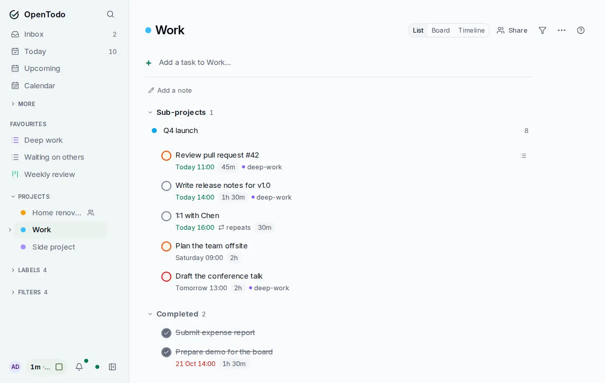

# Completed tasks in a project

<picture><source srcset="images/project-completed-dark.webp" media="(prefers-color-scheme: dark)"></picture>

A completed task normally leaves the project's list and shows up under **Completed** in the sidebar. That suits a project you work through once. For a list you tick off and use again, such as groceries or packing, you can keep the completed tasks in the project instead.

## Turn it on

Open the **Project** menu at the top right of the project and choose **Show completed tasks**. Choose it again to turn it off.

The project's completed tasks now stay at the end of the list in a **Completed** group:

- The group starts closed and its heading shows how many tasks it holds. Click the heading to open or close it; the app remembers which on this device.
- The most recently completed task comes first.
- Complete a task and it moves into the group. Untick a task in the group and it goes back among the open tasks, in its section.

A section whose tasks are all done no longer offers its own "n completed" while the Completed group is on, because the group already holds those tasks.

## Good to know

- The setting is per project and per device, like the board layout, and it is not synced. Turn it on separately on your phone and your computer.
- It applies to the list layout. The board and the timeline keep showing open tasks only.
- Every completed task, from every project, is still in **Completed** in the sidebar. See [Built-in views](built-in-views.md).
