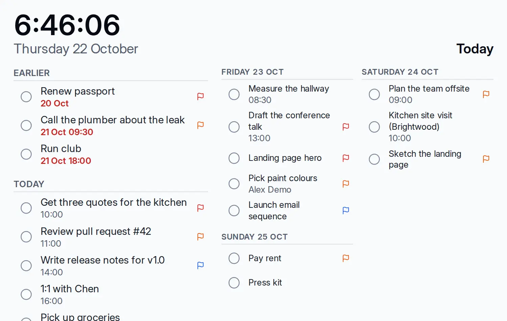

# Display mode

<picture><source srcset="images/display-today-dark.webp" media="(prefers-color-scheme: dark)"></picture>

Display mode shows one view full screen, in large type, with a clock and nothing else: no sidebar, menus, quick add or task panel. It is made for a tablet on the fridge or an e-ink panel by the door, readable from across the room.

## Open a display

Choose **Display mode** in the header of Today or Upcoming, in a project's menu, or in a saved view's menu. Each opens its own address, which you can bookmark:

- `/display/today` (or just `/display`): the clock and date, overdue and today's tasks, what was done today ticked below them, and the next three days as columns.
- `/display/upcoming`: the next seven days as columns.
- `/display/project/<id>`: the project's open tasks by section.
- `/display/view/<id>`: a saved view with its own grouping and sort.

**Exit**, in the bottom corner, or Esc returns to the same view in the app. The menu next to it makes this display the **start view on this device**, so a tablet opens straight into it after a restart.

## Make it readable

Options go in the address, so a bookmark keeps them:

| Option | Effect |
|---|---|
| `size=m`, `size=l`, `size=xl` | text of about 20, 24 (the default) or 32 px |
| `contrast=high` | black on white (white on black in dark mode), no soft tints |
| `motion=none` | nothing animates or fades |
| `days=1` … `days=7` | how many day columns |
| `eink=1` | high contrast, no motion and a clock without seconds, for e-ink |

For example, `/display/today?eink=1&size=xl`. The options apply only to the display; your theme and preferences stay as they are.

## Live and offline

The display reads the copy of your tasks on the device, so a task added or completed on a phone appears within seconds, and the list stays on screen when the network drops. A line at the bottom says when the device last synced.

A task can be completed or reopened with its checkbox or, on a keyboard, with Space or Enter on the focused row (arrows or `j` and `k` move). Only tasks you may edit have a checkbox: on a project you only view, nothing can be changed. The keys are in [Keyboard shortcuts](keyboard.md).

## Set up a shared screen

- **Use a viewer account.** A display is signed in like any device. For a screen others walk past, create an account for it ("Fridge") and share the household project with it as a **viewer**: the server refuses every change from that account. A display signed in as you can tick your tasks, and the rest of the app is one address away.
- **Lock the device.** The display hides the menus but is not a lock: turn on the tablet's kiosk, screen pinning or guided-access mode, and keep the screen awake in its settings (the display also asks the browser to).
- **Sign in again now and then.** Sessions last 90 days by default; whoever runs the server can change that with `OPENTODO_SESSION_DAYS`.
- **Browsers.** Android tablets and e-ink tablets with Chrome or another Chromium browser work; the Kindle browser does not.

To show a list with no account on the device at all, use a [public link](public-links.md#show-it-on-a-display) on a display.
