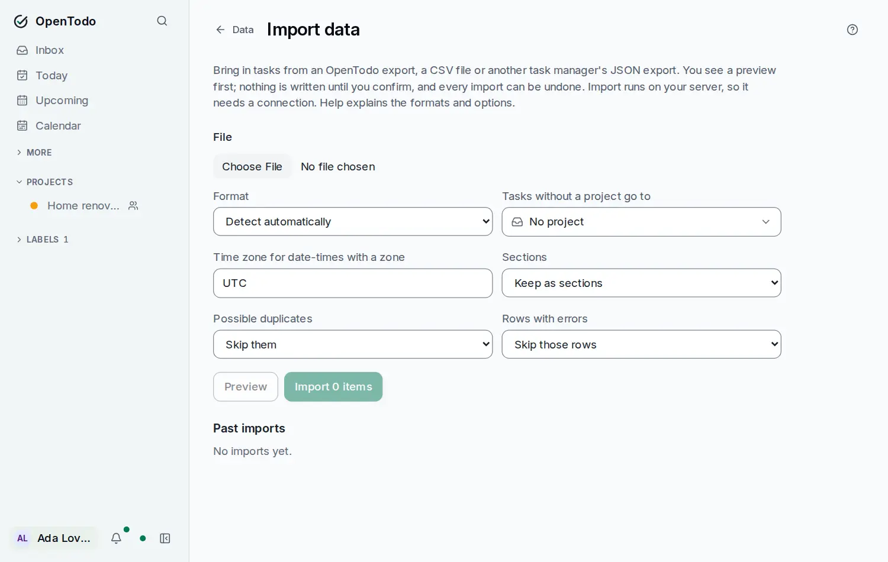

# Import and export

Your tasks are yours. You can download all of them at any time, and bring tasks in from other places. Nothing is locked in.

## Download everything

Open **Settings → Data** and select **Download export (JSON)** in the **Export** row. You get one file with all your projects, sections, tasks and subtasks, labels, reminders and saved views, including completed tasks and items in the Trash. Shared projects you're a member of are included too.

The file is plain JSON, so you can open it in any text editor, keep it as a backup, or load it into another OpenTodo server.

The JSON file lists your [attachments](attachments.md) but doesn't contain the files. To take the files with you, select **Download export with files (ZIP)** instead: you get the same JSON file plus every attached file, in one ZIP. Importing the JSON file alone brings back links and the names of files, but not the files themselves.

The person who runs your server can also set up automatic [backups](backups.md) of the whole server.

## Import from another app

Open **Settings → Data**, select **Import data…** (or press <kbd>g</kbd> then <kbd>Shift</kbd>+<kbd>I</kbd>) and choose a file. OpenTodo accepts:

- an **OpenTodo export**, for moving to another server or restoring (the ZIP export brings its attached files too),
- a **CSV file**, from a spreadsheet or a script, with a `title` column and optional columns for project, due date, priority, labels and more,
- **JSON exports from other task apps**, in the common shapes those apps use.

<picture><source srcset="images/import-dark.webp" media="(prefers-color-scheme: dark)"></picture>

Nothing is written straight away. OpenTodo first shows a preview:

1. **Check the format** it detected. You can change it if it guessed wrong.
2. **Choose the options**: which project gets tasks that have none, the time zone for dates, whether sections stay sections or become labels, and what to do with possible duplicates and with rows that have errors.
3. **Read the preview table.** Each row says what will happen: created, updated, skipped (with the reason) or an error (with the reason). Problems are listed first.
4. **Import.** The import runs on the server, and the tasks reach all your devices on their next sync.

Recurring rules, reminders, subtasks, sections and completed tasks come across where the file has them. Anything OpenTodo can't store is listed as a warning on its row, never dropped silently.

## Templates

A template is a project you want to start again and again: a trip checklist, a client onboarding, a weekly review. It's a small file in the same format as an export.

- **Save one**: open a project's menu and choose **Save as template…**. You get a file with the project, its sub-projects, sections, open tasks and the labels they use, with the dates as they are. Completed tasks, assignees, comments and reminders are left out. On an encrypted account the dialog warns you that the file isn't encrypted.
- **Start a project from one**: select **+** next to **Projects** in the sidebar, then **From a template…**, and pick the file. You see what it holds, choose a **Start on** day (today unless you change it) and an optional parent project, and select **Create**. Dates move together so the template's first day lands on your start day; times stay the same. You can start the same file as often as you like: each time is a new project.
- **Templates from the website**: the downloads on [open-todo.app/templates](https://open-todo.app/templates) are template files. Open them with **From a template…** to get fresh copies counted from your start day.

**From a template** and **Import** do different things with the same file: Import creates it once, with the ids and dates in the file (importing it again skips everything as existing), while From a template makes a fresh copy on your device, also offline. When you import a template file, the preview points you to From a template.

## Duplicates

Importing the same file twice won't double your tasks. OpenTodo recognises rows it imported before, and flags tasks that look like ones you already have (same title, project and due date). Those are skipped unless you choose **Import them anyway**.

For an OpenTodo export, items that already exist on the server are kept as they are, unless you choose to overwrite changed fields.

## Undo an import

Every import appears under **Past imports**, with a summary. **Undo** removes everything that import created and leaves the rest alone. Tasks you added later to an imported project move to your Inbox rather than disappearing. You can then import the same file again, for example with different options.

## Good to know

- Import needs a connection to your server.
- Files can be up to 20 MB and 50,000 rows, unless your server allows more.
- Comments aren't imported. The preview tells you how many there were.
- Attachments in a file from another app come across as links when they're web addresses. Anything else, like a file on someone's computer, is listed as a warning.
- Attached files count towards your attachments total, like files you add yourself. A file over the limit is skipped and listed under the import's errors.
- In a CSV file, write dates as `2026-10-15` and put a time like `09:30` in a `due_time` column. The [import reference](import.md#csv-csv) lists every column, with an example file.
- If a JSON export from another app isn't recognised, convert it to CSV. Every field OpenTodo stores can be written as a CSV column.

The [import formats reference](import.md) has the details: each format, how fields are mapped, recurring rules and reminders.
