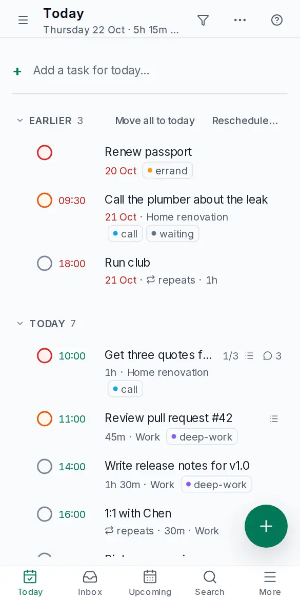

# Install on your phone

<picture><source srcset="images/mobile-today-dark.webp" media="(prefers-color-scheme: dark)"></picture>

Sign in once in the browser first, at your server's `https://` address; then add the app to your home screen. The general picture, and the steps for computers, are in [Installing the app](install-app.md).

## iPhone and iPad

1. Open your OpenTodo address in **Safari**.
2. Tap the **Share** button (the square with an arrow pointing up).
3. Scroll down and tap **Add to Home Screen**, then **Add**.

OpenTodo now has an icon on your home screen. Open it from there from now on. On iOS 16.4 and later, push notifications for reminders work only in the installed app, not in a Safari tab; turn them on in **Settings → Notifications** inside the app. See [Notifications](notifications.md).

Recent iOS versions also offer **Add to Home Screen** from the share menu of other browsers. If you don't see it, use Safari.

## Android

1. Open your OpenTodo address in **Chrome** (Edge and Samsung Internet work the same way).
2. Open the browser menu (⋮).
3. Tap **Install app**. On some versions it's called **Add to Home screen**.

Chrome sometimes shows an install banner at the bottom of the screen on its own; tapping it does the same thing.

After installing, OpenTodo also appears in Android's share menu, so you can send a link or some text from another app straight into a new task. See [Capturing pages](capture.md).
