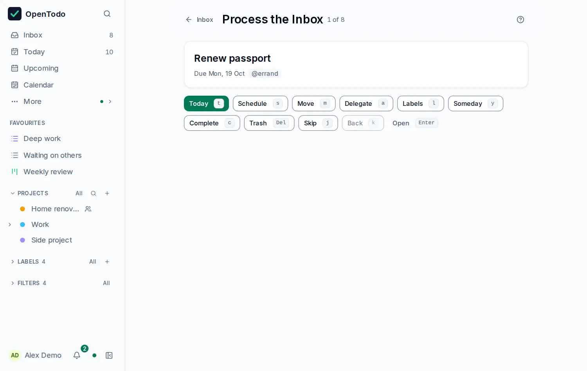

# Process the Inbox

<picture><source srcset="images/triage-dark.webp" media="(prefers-color-scheme: dark)"></picture>

Capture first, decide later. When the Inbox has piled up, select **Process** in its header (or press <kbd>g</kbd> <kbd>p</kbd>) and decide each task in turn, keyboard only if you like. One task is shown at a time with its notes, date and labels, and "4 of 17" tells you how far you are.

## Decide each task

| Key | Decision |
| --- | --- |
| <kbd>t</kbd> | Due today |
| <kbd>s</kbd> | Schedule: type a date (`fri`, `3/11`) and press <kbd>Enter</kbd> |
| <kbd>m</kbd> | Move to a project |
| <kbd>a</kbd> | Delegate: move it into a shared project and assign it to someone there, in one step |
| <kbd>l</kbd> | Labels. This one doesn't move on, so you can add a label and then decide |
| <kbd>y</kbd> | Park it in [Someday](built-in-views.md#park-ideas-in-someday) |
| <kbd>c</kbd> | Complete |
| <kbd>Delete</kbd> | Move to the Trash |
| <kbd>j</kbd> or <kbd>Space</kbd> | Skip it for now |
| <kbd>k</kbd> | Back to the previous task |
| <kbd>Enter</kbd> | Open the task's panel to edit anything else; <kbd>Esc</kbd> comes back |

Every decision moves on to the next task and shows **Undo** for a few seconds. The buttons under the card do the same by mouse or touch. Delegating needs a project you share with someone; until you have one, the button says so.

## The queue

The queue is the Inbox in its order when you start. Tasks captured meanwhile, on any device, join the end; a task someone moves out of the Inbox elsewhere drops out, and the mode tells you. When nothing is left you see **Inbox zero** and the way back.

<kbd>Esc</kbd> returns to the Inbox with the task you were on selected. It all works offline, like any edit, and with Vim keybindings on, <kbd>x</kbd>, <kbd>dd</kbd>, `:triage` and `:q` work too.
