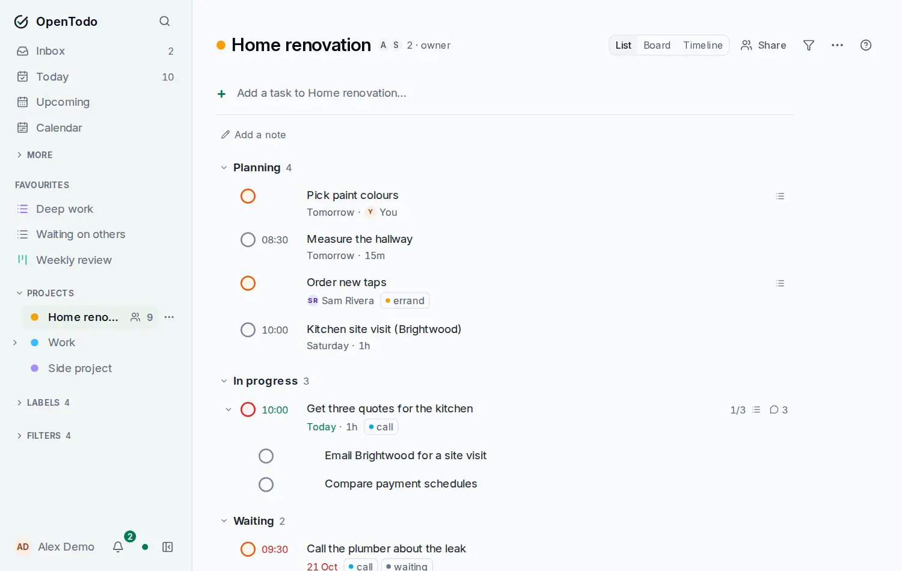

# A project on a timeline

<picture><source srcset="images/project-list-dark.webp" media="(prefers-color-scheme: dark)"></picture>

Choose **Timeline** at the top of the project (or press <kbd>v</kbd> until it shows). Each open task is a row, in list order under its sections and with subtasks indented. Its bar runs from its start to its due date or deadline, whichever is later; a task with a single date gets a one-day bar. A thin mark shows the due day inside a longer bar, a flag shows the deadline, and a deadline that has passed turns the bar red. Tasks with no dates, or parked in Someday, wait under **Unscheduled** at the end.

- **Drag a bar** to move all its dates by the same number of days. The due time stays the same.
- **Drag the left or right end** to set the start or the deadline. If the task has none yet, one is created.
- **Drag an unscheduled task** from its name onto a day to give it that due date.
- **Keyboard:** select a task with <kbd>j</kbd> and <kbd>k</kbd>, then <kbd>←</kbd> and <kbd>→</kbd> move its dates a day. <kbd>Shift</kbd>+<kbd>←</kbd> and <kbd>Shift</kbd>+<kbd>→</kbd> move its deadline, starting from the due date when it has none. <kbd>Enter</kbd> opens it.
- **Days** and **Weeks** change the scale. <kbd>[</kbd> and <kbd>]</kbd> move the visible range, and <kbd>t</kbd> comes back to today.

When one task [waits for another](tasks-and-projects.md#wait-for-another-task) in the same project, an arrow joins them and the waiting task is dimmed until the other is done. Moving a task never moves the tasks that wait for it. Viewers of a shared project see the timeline but can't change dates. On a phone the task names stay in place while the dates scroll sideways, and you press and hold a bar to drag it.

Sections and the board layout of the same project are described in [Sections and boards](sections-and-boards.md).
