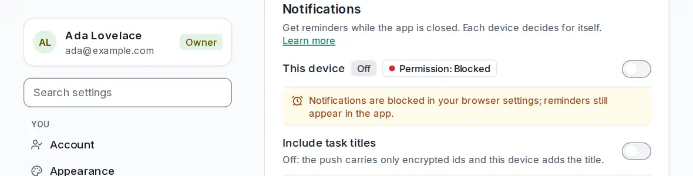

# Check that push works

<picture><source srcset="images/settings-notifications-dark.webp" media="(prefers-color-scheme: dark)"></picture>

After you [turn on push notifications](push-notifications.md) on a device, the same page shows whether reminders can actually reach it.

## Check that it works

Below the options, **Delivery check** lists everything push needs on this device, with a fix next to each problem:

| Step | What it means |
| --- | --- |
| Browser supports push | Private windows and some browsers can't receive push at all. |
| Notifications allowed | You allowed notifications for this site when the browser asked. |
| Offline service worker active | The background part of the app that receives pushes is running. Reload if it isn't. |
| Subscribed on the server | Your server knows where to send pushes for this device. Select **Enable** if not. |
| Server reaches the push service | The last push to this device went through. After failures it shows the error; select **Re-enable**. |
| Test notification received | This device reported the last test. |

After **Send test notification** you see one of these:

- **Received on this device**: the push arrived and the notification was handed to your system. Reminders will reach this device while the app is closed. If you still saw no banner, your operating system hid it (see [When notifications don't arrive](push-notifications.md#when-notifications-dont-arrive)).
- **Accepted, but this device has not reported receiving it**: your server delivered the push to the browser's push service, but nothing reached this device within a few seconds. Check the operating system's notification settings for your browser or the app, focus and do-not-disturb modes, and on iPhone and iPad use the installed app. If it arrives late, the result updates to received.
- **This device is not subscribed**: nothing was sent. Turn on **Enable notifications on this device** first.
- **The subscription expired**: the push service no longer accepts it and your server removed it. Select **Enable** to subscribe again.
- **The push service rejected the test**: the message shows its answer. Try **Re-enable**; if it keeps failing, the push service may be unreachable from your server.

You can run up to five tests in ten minutes. Without a subscription, **Show a local notification** shows one straight from the page: it only proves that the browser may show notifications, not that reminders reach the device.
