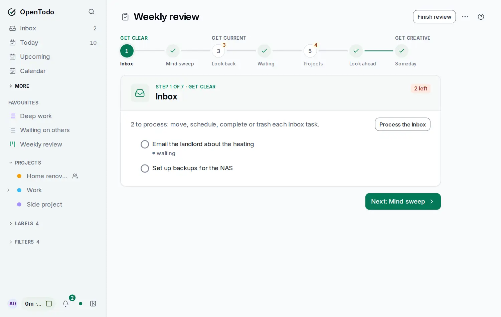
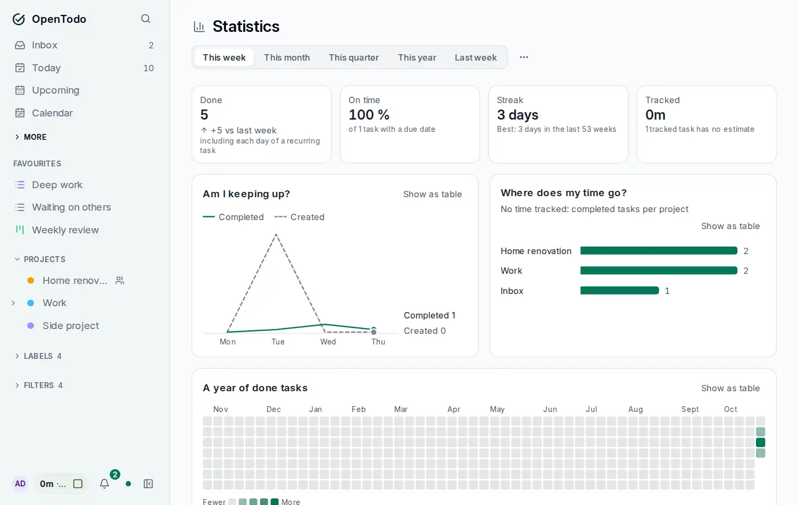

# Weekly review and statistics

<picture><source srcset="images/review-dark.webp" media="(prefers-color-scheme: dark)"></picture>

Once a week, look back at what happened and set up the week ahead. Open **Review** in the sidebar (under More) or press <kbd>g</kbd> <kbd>r</kbd>.

## The four steps

The review opens on the first step that is not done. Move between steps with the arrow keys; each tab shows how much is left or a check mark.

1. **Get clear**: the open tasks in your Inbox. It is done when the Inbox is empty. **Process the Inbox** walks them one at a time ([Process the Inbox](process-the-inbox.md)).
2. **Look back**: how many tasks you completed this week, and what is overdue. Complete one with <kbd>c</kbd> or open it to give it a new date. Done when nothing is overdue.
3. **Next actions**: projects with no open task. Choose **Add a next action** (or select the row with <kbd>j</kbd> and press <kbd>Enter</kbd>) to add a task to it, or **Archive** a finished project ([Archived projects](archived-projects.md)). Shared projects you can only view are not listed.
4. **Look ahead**: what is due today and in the next six days. Set priorities with <kbd>1</kbd> to <kbd>4</kbd>.

The task lists use the usual list keys. Everything works offline.

## Finishing a review

**Finish review** records the time. It syncs to all your devices, so your phone knows when you last reviewed on your laptop. In the sidebar, Review shows how long ago that was, and a **Due** marker once it is more than seven days ago, or if you never finished one. The marker also shows on **More** while it is closed.

## Statistics

<picture><source srcset="images/stats-dark.webp" media="(prefers-color-scheme: dark)"></picture>

Open **Statistics** under More, or press <kbd>g</kbd> <kbd>Shift+S</kbd>. Choose this week, last week, the last 4 or 12 weeks with the arrow keys. Weeks start on your [first day of the week](dates-and-times.md).

- **Completed**: tasks and subtasks completed in the period. Each day of a recurring task counts once; a skipped day of a habit never counts.
- **Created**: new tasks. Completing a recurring task does not create one.
- **Completed late**: completed on a day after the due day.
- **Slipped**: due in the period, before today, and not done by the end of the period.
- **Overdue now**: open and due before today, outside archived projects.

Charts show completions per day, per week, per weekday and per project (the top five and "other"). Every value is printed, and screen readers get a table. Tasks in the Trash are left out.

In a shared project a completed task counts for whoever completed it. Older tasks that do not record that count for their assignee, or for you when unassigned.

Statistics are computed on this device from your tasks. Nothing is sent to the server or stored, they work offline, and every synced device shows the same numbers. With end-to-end encryption the numbers are the same and project names are decrypted on your device.

## Weekly digest by email

In **Settings → Notifications → Weekly digest**, turn on an email for your review day: last week's numbers, overdue tasks, what is due in the next seven days, projects without a next action, when you last reviewed, and a link to the review. Pick the day and hour; your time zone and language come from the browser and are shown on the card.

The digest uses the same definitions as Statistics. It needs [outgoing email](self-hosting/outgoing-email.md) set up by the server owner, contains task names, and is not available with end-to-end encryption: turning encryption on switches it off. A failed send is retried for six hours.
