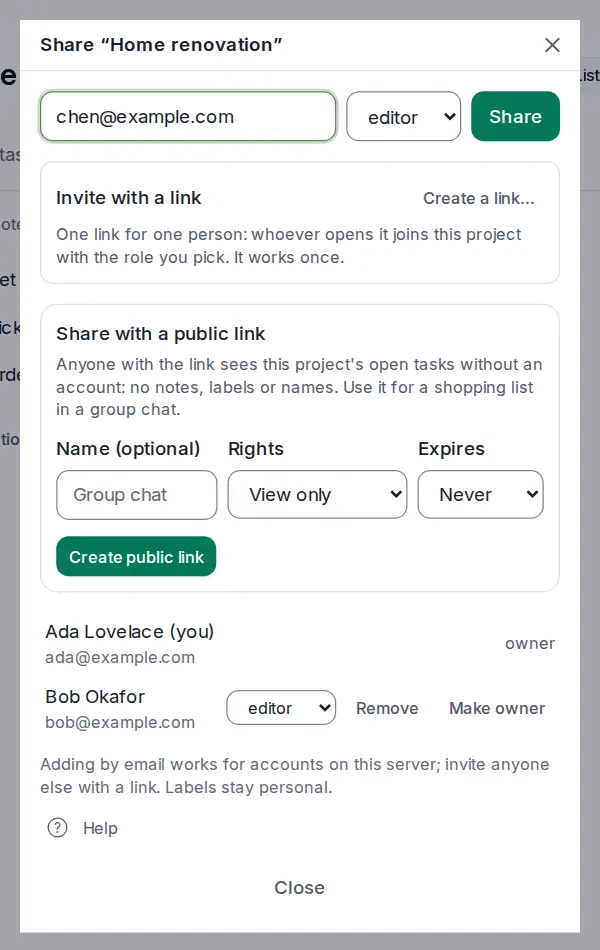

# Roles and assignments

<picture><source srcset="images/share-dialog-dark.webp" media="(prefers-color-scheme: dark)"></picture>

Every member of a shared project has a role that says what they can do, and every task in it can be assigned to one of them. Both are set in the Share dialog and the task panel; [Sharing and comments](sharing.md) has the overview.

## Choose a role

| Role | Can |
| --- | --- |
| **viewer** | see the project and its tasks, and comment |
| **editor** | also add, edit, complete and delete tasks, assign them, and edit the project's [note](project-notes.md) |
| **admin** | also rename, recolor and archive the project, and manage members |
| **owner** | everything, including deleting the project and handing it over |

Every project has exactly one owner. To change someone's role, open **Share** and pick a new one next to their name. **Remove** takes them out of the project.

For viewers, the project is read-only: the add box and edit controls are switched off, with a note saying so.

## Leave or hand over a project

- **Leave**: in the Share dialog, select **Leave** next to your own name. The project disappears from your devices; everyone else keeps it.
- **Make owner**: the owner can hand the project to another member. The previous owner becomes an admin. Owners can't leave until they've done this.

When someone leaves or is removed, tasks assigned to them become unassigned.

## Assign tasks

In a shared project, each task can be assigned to one member. Open the task and choose someone under **Assignee**, or select the task and press <kbd>Shift</kbd>+<kbd>A</kbd>, type a name and press <kbd>Enter</kbd>. The assignee's avatar shows on the row, and they get a notification.

**Assigned to me** in the sidebar (<kbd>g</kbd> <kbd>a</kbd>) lists every open task assigned to you, across projects.

In your Inbox, in a project you haven't shared, or in a shared project where you are the only member, nobody else can be assigned, so the **Assignee** row reads **You**. That is only how the panel shows it: such a task is not in **Assigned to me** unless you turn on **Show in Assigned to me** in the same row, which assigns it to you. Turning it off unassigns it again. When you share the project with someone, its unassigned tasks read **Unassigned** from then on, and the tasks you assigned to yourself stay yours.
