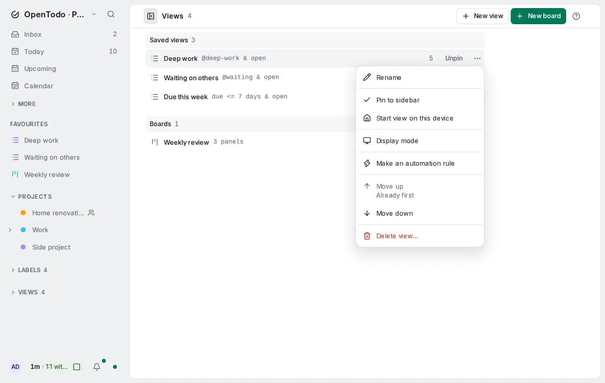
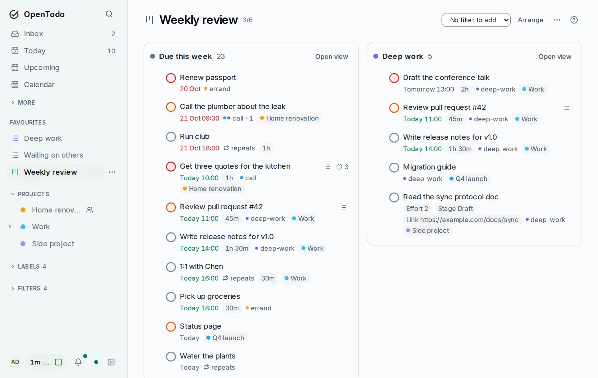

# Saved views

<picture><source srcset="images/filter-dark.webp" media="(prefers-color-scheme: dark)"></picture>

When the built-in views aren't enough, describe the tasks you want with a filter query and save the result as a view of your own. Saved views sync to all your devices, and a dashboard shows several of them at once.

## Save your own views

Describe what you want in the **Filter** view, then save it. For example, `blocked` lists every task waiting for another one (save it as **Waiting for**), `@waiting & open` lists everything you labelled as waiting, and `due <= 7 days & p1` shows urgent tasks for the coming week. The filter language is explained in [Labels and filters](labels-and-filters.md), and [Filter queries](filters.md) has ten ready-made examples to copy.

To save the current filter, press <kbd>s</kbd> in the results (or use the save button), and give it a name. Saved filters are pinned to the **Views** group in the sidebar with a live count, and they sync to all your devices.

Each saved view can group its tasks (by project, date, priority or label) and sort them (by date, priority, your own order, creation time or title). Change these from the top of the view. To change the query itself, press <kbd>/</kbd>, edit it and press <kbd>Enter</kbd>.

The **All** link next to **Filters** (or <kbd>g</kbd> <kbd>v</kbd>) opens the list of all your saved filters and boards. From there you can rename, reorder, unpin or delete them.

Every saved view has the same menu, wherever you open it: the **⋯** button on its row in the sidebar or the views list, its header, or a dashboard. With a row focused, <kbd>.</kbd> (or <kbd>Shift</kbd>+<kbd>F10</kbd>) opens it too.

- **Rename**.
- **Pinned to sidebar** and **Start view on this device**: a check mark shows which apply.
- **Move up** and **Move down**: unavailable at the top or bottom of the list, with the reason shown.
- **Delete view…** asks for confirmation first. Deleting a view never touches your tasks.

<picture><source srcset="images/view-menu-dark.webp" media="(prefers-color-scheme: dark)"></picture>

## Build a dashboard

A dashboard puts up to six saved views side by side, each showing its count and first ten tasks. It's handy for a morning review: "Due this week", "Deep work" and "Waiting on others" on one screen.

<picture><source srcset="images/dashboard-dark.webp" media="(prefers-color-scheme: dark)"></picture>

Open the views list (<kbd>g</kbd> <kbd>v</kbd>), choose **+ New dashboard**, name it, then add saved views as panels from the dashboard's header. On a phone the panels stack. Move between panels with <kbd>Tab</kbd>, and through a panel's tasks with <kbd>j</kbd> / <kbd>k</kbd>.

Each device can open on a saved view or a dashboard: see [Choose where the app opens](views.md#choose-where-the-app-opens).
