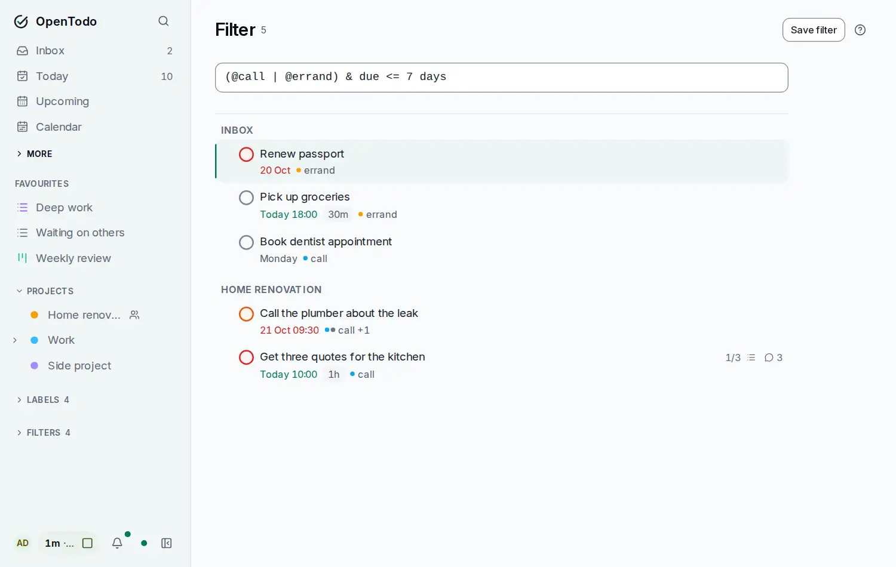

# Search and commands

<picture><source srcset="images/filter-dark.webp" media="(prefers-color-scheme: dark)"></picture>

Press <kbd>Ctrl</kbd>+<kbd>K</kbd> (<kbd>⌘</kbd>+<kbd>K</kbd> on a Mac) anywhere in the app to find anything or do anything by name. It also works while you are typing in a field, except in a task's notes, where the same keys insert a link.

## Open the box

Use the shortcut, or the magnifying glass at the top of the screen. On a phone the box opens as a sheet from the bottom. Type, move with <kbd>↑</kbd> and <kbd>↓</kbd>, and press <kbd>Enter</kbd>; <kbd>Esc</kbd> closes it and returns you where you were.

With nothing typed, the box lists what you can do right now (for the selected task, the project or view you are in) and what you picked most recently on this device.

## Four modes

**Search**, **Add**, **Commands** and **Ask** (when the assistant is on) switch what the box does: the strip at the bottom names their first characters, and a phone shows buttons. <kbd>+</kbd> adds a task with [quick add](quick-add.md#in-the-command-bar), <kbd>></kbd> lists commands and <kbd>?</kbd> asks the assistant; typing it again returns to Search. <kbd>Esc</kbd> returns to Search first. The last search result is always **Add "…" as a task**; <kbd>Ctrl</kbd>+<kbd>Enter</kbd> picks it. On screens without a quick add, <kbd>q</kbd> opens the box in Add mode.

## What it finds

- **Tasks**, by title and by the text of their notes. Open tasks come first; completed ones are marked. Deleted tasks never show up. Picking a task opens its project with the task's panel open.
- **Projects** (archived ones are marked), **labels**, **saved views and dashboards**, and the **Settings** sections you can see.

Matching ignores case and accents and finds words by their start or by letters in order: `cafe` finds *Café*, `rp` finds *Renew passport*. Exact matches come first; among equal matches, what you picked often on this device comes first. At most 50 results are listed; keep typing to narrow them down.

## Filter queries inline

If what you type is a [filter query](filters.md), such as `@errand & p1`, `due <= friday` or `#Work & overdue`, the box lists the matching tasks and offers **Open as a new view**. Plain words are always a text search, so a half-typed query never shows an error.

## Commands

Every action has a name in the box: go to any view, calendar or Settings section; act on the selected task (complete, priority, labels, assign, estimate, deadline, defer, park, This Evening, schedule, skip an occurrence, move to the Trash); act on the project, saved view, label or section you are in (everything in their menus, such as *Pin to sidebar* or *Archive*); save the current filter as a view; create a task, project, label or dashboard; sync now; show the keyboard shortcuts; turn Vim keybindings on or off; search Help for what you typed. Each command shows its keys (*G then U*), so the box also teaches them.

Commands are listed only when they apply: with no task selected there are no task commands, and a viewer of a shared project doesn't see the ones that would change it.

## Privacy

The search runs on your device, over the data already stored there. Nothing you type is sent to the server, and nothing is indexed on it. This works offline and for end-to-end encrypted accounts too: your device holds the decrypted text and searches that.
