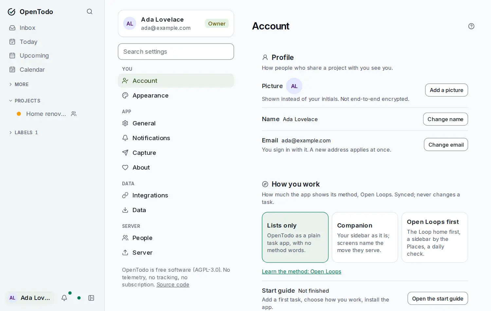

# Settings

Open **Settings** with the gear next to your name at the bottom of the sidebar, or press <kbd>g</kbd> then <kbd>s</kbd>. On a wide screen the list of sections is the left column and the first section, **Account**, is already open beside it; on a phone you see the list first and each section opens as its own page with a **← Settings** link back. The list starts with your profile card (your initials, name, email and role) and a **Search settings** field, then the sections grouped under **You**, **App**, **Data** and, for the people who run the server, **Server**. Each section has an icon and a line saying what's inside.

<picture><source srcset="images/settings-dark.webp" media="(prefers-color-scheme: dark)"></picture>

Type in **Search settings** to find a setting by name or by what it does: matches are listed under their section, and Enter opens the first one with that row focused. The same index is in the command palette (<kbd>Ctrl</kbd>/<kbd>⌘</kbd>+<kbd>K</kbd>): typing "passkey" there lists **Account › Passkeys**.

Every section has its own address, such as `/settings/integrations`, so you can bookmark it or share a link with someone on the same server. Older links keep working: `/settings/security` opens **Account** at its security rows, `/settings/preferences` opens **General**, and so on.

Inside a section, each card leads with a heading and one sentence saying what it is for, then its settings as rows with the label and description on the left and the control on the right; on a narrow screen the control sits below its label. The current state of a setting is a badge beside its label. Forms with several fields open from a button, and actions that remove something ask you to confirm first and say what will be lost.

Some settings follow your account to every device. Others belong to the device you're on, so your phone and laptop can be set up differently. Settings that apply to one device say "this device" next to them.

Each section page has a **Help** button in its header that opens its part of this guide next to Settings.

What you see depends on your role: the owner and admins also see **People**, and the owner alone sees **Server**. On the public demo every section is listed; the rows the demo refuses are shown with their controls disabled, under a note at the top of the page naming them.

## You

### Account

- **Profile**: your initials, name, email and role.
- **Session**: **Sign out of this device** removes your tasks from this device; changes not yet sent are uploaded first, and the app asks you to confirm.
- **Password**: **Change password** opens the form. See [Account security](account-security.md#change-your-password).
- **Two-factor authentication**: a code from your phone on top of your password. The badge shows whether it's on, and the card warns when only a few recovery codes remain. See [Account security](account-security.md#turn-on-two-factor-authentication).
- **Passkeys**: sign in with your fingerprint, face or device PIN. See [Account security](account-security.md#sign-in-with-a-passkey).
- **Linked accounts**: connect a single sign-on login, if your server offers one.
- **End-to-end encryption**: encrypt your task text on your devices, and keep its recovery key. See [End-to-end encryption](e2ee.md).
- **Recent activity**: sign-ins and token changes from the last 90 days.

### Appearance

Four choices that follow your account to every device, also when you change them offline:

- **Mode**: **System** follows your device's light or dark setting (the default), **Light** and **Dark** keep the app that way whatever the device says.
- **Theme**: the colour of buttons, links, the focus ring and selected items: **Emerald** (the default), **Blue**, **Indigo**, **Violet**, **Rose**, **Orange**, **Teal** or **Graphite**. Each tile previews its theme; with the keyboard, the arrow keys move between them. On a phone the tiles are one row of swatches you can scroll sideways.
- **Density**: **Comfortable** (the default) or **Compact**, which makes task rows, group headers and the sidebar tighter. On a touch screen every target stays full size in both.
- **Sidebar**: one switch per destination of the sidebar's **More** group (Anytime, Someday, Assigned to me, Completed, Updates, Trash, Filter). A destination you switch on moves up next to Inbox, Today, Upcoming and Calendar.

Mode and theme apply at once, without a reload. They never change other people's app. Priority colours (P1 to P4), warnings and errors, and the colours of your projects, labels and views keep their meaning in every theme. The installed app's title bar follows the theme too; the splash screen when it starts stays neutral, because it is the same for everyone on the server. Every theme meets the same contrast rules in light and dark.

## App

### General

How the app behaves.

- **Start view**: the view this device opens on. See [Views](views.md#choose-where-the-app-opens).
- **Date and time**: how dates and times look and where weeks start, on all your devices (see below).
- **Calendar**: when the Day and Week grid starts and ends, and how long your working day is. See [Time blocking](time-blocking.md#adjust-the-grid).
- **Keyboard**: **Show shortcut hints** prints the keys in the app itself (next to quick add, beside the sidebar's destinations, in prompts) as well as in tooltips and menus, and **Vim keybindings** turns the Vim layer on; both for this device. See [Keyboard shortcuts](keyboard.md#vim-keybindings).

#### Date and time

Three choices that follow your account to every device, also when you change them offline:

- **Date format**: **System** (the way this browser writes dates), **Day-month** (`14 Oct`, `14/10/2026`), **Month-day** (`Oct 14`, `10/14/2026`) or **ISO** (`2026-10-14`). Each option shows today's date in that format. Month and weekday names stay in your browser's language.
- **Time format**: **System**, **12-hour** (`3:00 PM`) or **24-hour** (`15:00`).
- **First day of the week**: **System**, **Monday**, **Sunday** or **Saturday**. It decides where the Week view and the calendar of a date field start.

The **Preview** shows a due date, a date, a due time, a comment time and this week as they will appear. A change applies at once everywhere in the app, without a reload: task rows, the task detail, reminders, the Day and Week views, comments, history and the lists in Settings. With a numeric date order on **Automatic**, quick add reads dates like `3/11` in your date format too.

### Notifications

Push notifications for reminders on this device, and a test that shows whether they arrive. See [Notifications](notifications.md).

### Capture

- **Quick add**: turn natural-language parsing on or off, pick the languages it understands, and the order of day and month in dates like `12/11`. See [Quick add syntax](quick-add.md#languages).
- **Voice capture**: dictate tasks into quick add. Off until you turn it on, and the app explains first what your browser does with the audio. See [Quick add syntax](quick-add.md#voice).
- **Bookmarklet and extension**: the **Add to OpenTodo** bookmarklet, to save the page you're reading as a task. See [Capturing pages](capture.md).
- **Email to task**: your own secret address; emails sent there become tasks. See [Email to task](email.md).

## Data

### Integrations

These cards connect OpenTodo to other tools. Some appear only when the person running your server has switched the feature on.

- **Calendar apps (CalDAV)**: see your tasks in calendar and reminder apps on your phone or computer, with an app password. See [Calendar apps](caldav.md).
- **Calendar feeds**: show your Google, Outlook or Apple calendars in Day and Week, and get a private address that lets calendar apps show your tasks. The server owner turns it on here. See [Calendar feeds](calendar-feeds.md).
- **Webhooks**: send a message to another service when tasks change. See [Webhooks](webhooks.md).
- **API tokens**: keys for scripts and the `ot` command-line client. A token is shown once, when you create it. Read-only tokens can't change anything; tokens for an AI assistant that can make changes work only through the assistant tools and never on the rest of the API. See [HTTP API](api.md) and [Command-line client](cli.md).
- **Assistant**: the in-app assistant, when the server owner has turned it on: your consent, which assistant you use (the server's, or your own Anthropic, OpenAI or Gemini provider, model and key, if allowed), this month's usage, **Apply small changes without review (this device)** and **Clear conversations on this device**. The owner also chooses the provider, models, keys, network and monthly allowance here. See [AI assistant](assistant.md).
- **AI assistants**: give an AI assistant read-only access to your tasks, or, when the server owner allows it and you switch on **Allow AI assistants to make changes**, a token for an assistant that can make changes you can undo. See [AI assistants (MCP)](mcp.md). A token you create here is also listed under **API tokens**.

### Data

**Download export (JSON)** saves everything you have in one file, and **Download export with files (ZIP)** adds your attached files. **Import data…** brings in tasks from a file. See [Import and export](import-export.md). **Attachments** shows how much of your total your files use and how large one file may be (see [Attachments](attachments.md)). The sync status of this device is shown too.

**Projects**: archive projects automatically after 30 days without open tasks, and bring back archived projects with **Restore**. See [Trash and history](trash-and-history.md#archived-projects).

## Server

Only the owner and admins see this group; **Server** and the access policies inside **People** are for the owner only.

### People

- **Users**: everyone with an account, their role and last sign-in. Make someone an admin (owner only), deactivate or reactivate an account, create a password reset link, or delete an account.
- **Members**: invite people with a single-use link. See [Sharing and comments](sharing.md#invite-someone-new).
- **Two-factor policy** (owner only): optional, required for the owner, or required for everyone. See [Account security](account-security.md#turn-on-two-factor-authentication).
- **Single sign-on** (owner only): sign-in through your company or family identity provider. See [Single sign-on](self-hosting/sso.md).
- **Project invite links** (owner only): **Members can invite new people with project links** (off by default) lets links that members create in a project's Share dialog also create accounts. See [Who can bring new people](sharing.md#who-can-bring-new-people).

### Server

- **Backups**: scheduled backups to a folder, S3 or WebDAV, the last run and its result, and the next one. **Restore from a backup** puts the whole server back to an archive from the destination or one you upload: you see a verified preview first, type `RESTORE` to confirm, and the server restarts into the restored data. **Undo last restore** puts the previous database back, and old safety copies can be deleted to free space. See [Backups](backups.md#restore-from-the-web-app).
- **Attachments**: turn attachments on or off, and set the size per file (25 MB unless changed, up to 2048 MB) and the total per account (1 GB unless changed; 0 means no total). See [Attachments](attachments.md#limits).
- **Audit log**: what changed on the server and who did it, with its retention settings.

Running the server itself is covered in [Running with Docker](self-hosting/docker.md).
