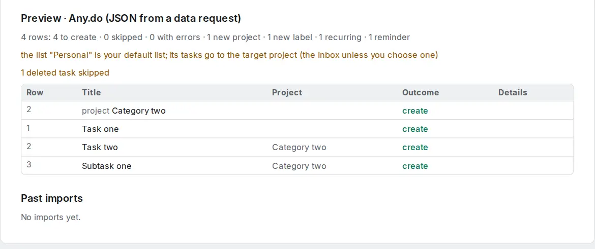

# Switch from Any.do

Any.do has no export button, but it sends you a copy of your data when you ask for it.

## Request your data from Any.do

1. In Any.do, open **Settings → Privacy** (on the web: your profile, then **Privacy**), and choose **Request my data** (or write to Any.do's support asking for a copy of your personal data).
2. Any.do emails you a download, usually within a few days. Unpack it if it is a ZIP; the tasks are in a `.json` file.

Any.do does not document this file, and its format may change without notice. If the import does not recognise your file, [tell us](../feedback-and-support.md) and attach a copy with the personal text removed.

## Import into OpenTodo

1. Open **Settings → Data → Import data** (or press `g` then `Shift+I`).
2. Choose the JSON file. The preview shows **Any.do (JSON from a data request)**.
3. Check the warnings and select **Import**.

<picture><source srcset="../images/import-anydo-dark.webp" media="(prefers-color-scheme: dark)"></picture>

## What carries over

- Each list becomes a project. Your default list (usually **Personal**) goes to your Inbox or the target project.
- Titles, notes (as the description) and subtasks.
- High priority becomes p1.
- Due dates, with their time unless the task was due "any time" that day.
- Daily, weekly, monthly and yearly repeats.
- Tags as labels, and the reminder as a reminder at the same moment.
- Completed tasks, with their time.

The full mapping is in [Import formats](../import.md#anydo-anydo-json).

## What does not

- Deleted tasks are in the file but skipped; the preview says how many.
- Shared lists: other members are dropped with a warning; [share the project](../sharing.md) again.
- Attachments are not in the file.
- The "My Day" plan is dropped; use [Today](../built-in-views.md) instead.
