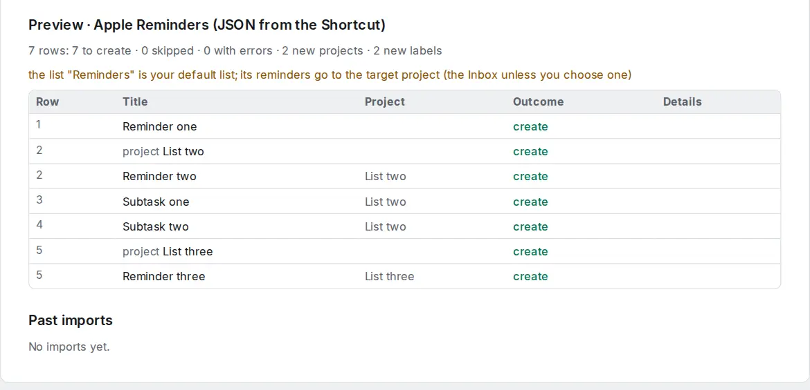

# Switch from Apple Reminders

Apple Reminders has no export button. There are two ways over.

## First choice: CalDAV

If you want to keep using the Reminders app on your iPhone or Mac, connect it to OpenTodo with [CalDAV](../caldav.md): your OpenTodo projects appear as Reminders lists, and what you add on either side shows up on the other. Then move reminders into those lists. Nothing needs to be exported.

## Or: save your reminders with a Shortcut

To bring everything in at once, build this Shortcut in the Shortcuts app (iPhone, iPad or Mac):

1. **Find Reminders** where **Is Completed** is any value (leave the other filters empty).
2. **Repeat with Each** item in **Reminders**. Inside the repeat:
   - **Format Date** of **Repeat Item → Due Date**, format **ISO 8601**, **Include ISO 8601 Time** on. Do the same for **Creation Date** and **Completion Date**.
   - **Dictionary** with these keys (all Text unless stated): `identifier` = the formatted creation date followed by **Title**; `parent` = **Parent Reminder → Creation Date** (formatted) followed by **Parent Reminder → Title**; `list` = **List**; `title` = **Title**; `notes` = **Notes**; `dueDate`, `creationDate`, `completionDate` = the formatted dates; `isCompleted` (Boolean) = **Is Completed**; `priority` = **Priority**; `flagged` (Boolean) = **Is Flagged**; `tags` = **Tags**; `url` = **URL**.
3. After the repeat: **Combine** **Repeat Results** with **,**, then **Text** with `[`, the combined text, and `]`.
4. **Save File** with that text, named `reminders.json` (turn off **Ask Where to Save** to put it in your Shortcuts folder in Files or iCloud Drive).

Run it once. The file holds every reminder of every list.

## Import into OpenTodo

1. Open **Settings → Data → Import data** (or press `g` then `Shift+I`).
2. Choose `reminders.json`. The preview shows **Apple Reminders (JSON from the Shortcut)**.
3. Check the warnings and select **Import**.

<picture><source srcset="../images/import-apple-reminders-dark.webp" media="(prefers-color-scheme: dark)"></picture>

## What carries over

- Each list becomes a project. **Reminders**, the default list, goes to your Inbox or the target project.
- Titles, notes (as the description) and subtasks.
- Priority High, Medium and Low become p1, p2 and p3.
- Flagged reminders get the label `flagged`; tags become labels.
- The URL becomes a link attachment.
- Due dates, with the time when the reminder has one; completed reminders with their time.

The full mapping is in [Import formats](../import.md#apple-reminders-apple-reminders-json).

## What the Shortcut cannot read

Shortcuts does not give access to repeat rules, early reminders, location alerts, images or the sections of a list, so those are not in the file. Set [repeat rules](../recurrence.md) and [reminders](../reminders.md) again in OpenTodo where you need them.
