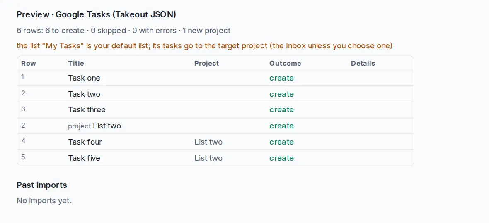

# Switch from Google Tasks

Your lists, subtasks, notes, due dates, completed tasks and links come with you.

## Export from Google Tasks

1. Open [takeout.google.com](https://takeout.google.com) and select **Deselect all**.
2. Tick only **Tasks**, then **Next step** and **Create export**.
3. When Google's email arrives, download the archive and unpack it. Inside `Takeout/Tasks/` is `Tasks.json`.

## Import into OpenTodo

1. Open **Settings → Data → Import data** (or press `g` then `Shift+I`).
2. Choose `Tasks.json`. The preview shows **Google Tasks (Takeout JSON)**.
3. Check the warnings and select **Import**.

<picture><source srcset="../images/import-google-tasks-dark.webp" media="(prefers-color-scheme: dark)"></picture>

## What carries over

- Each list becomes a project. **My Tasks**, your default list, goes to your Inbox, or to the project you choose as the target.
- Titles, notes (as the description) and subtasks.
- Due dates, exactly as Google Tasks shows them. The file has no times, so none are set.
- Completed tasks, with the time they were completed.
- Links attached to a task (for example the email it came from) become link attachments.
- Each task remembers it came from Google Tasks (`origin: google-tasks`).

The full mapping is in [Import formats](../import.md#google-tasks-google-tasks-json).

## What does not

- Google Tasks has no priorities, labels or reminders, so imported tasks have none.
- Repeating tasks: Takeout writes only the next occurrence, without the rule. Set the [repeat rule](../recurrence.md) again on the task.
- Deleted tasks are in the file but skipped; the preview says how many.
