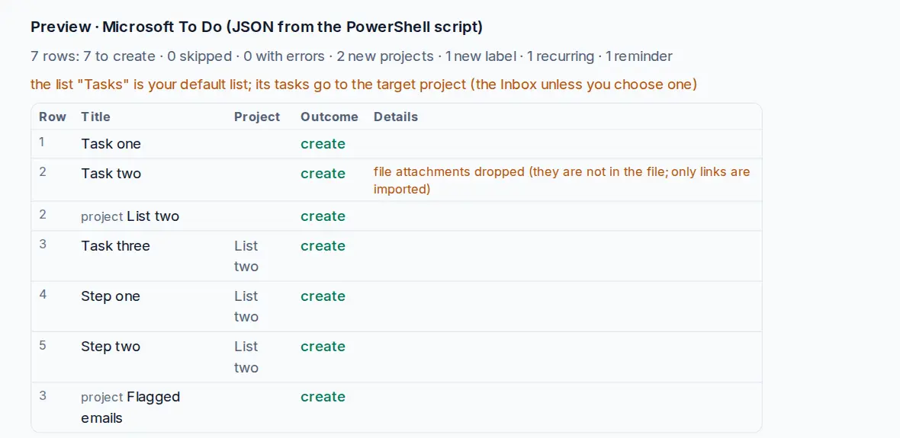

# Switch from Microsoft To Do

Microsoft To Do has no export button, but Microsoft Graph, the service behind it, lets you read your own lists. A short PowerShell script saves them to one file that OpenTodo imports.

## Save your lists with PowerShell

You need PowerShell 7 (Windows, macOS or Linux). Run these lines in it:

```powershell
Install-Module Microsoft.Graph.Authentication -Scope CurrentUser
Connect-MgGraph -Scopes "Tasks.Read"

function Get-All($uri) {
  $items = @()
  while ($uri) {
    $page = Invoke-MgGraphRequest -Method GET -Uri $uri
    $items += $page.value
    $uri = $page.'@odata.nextLink'
  }
  return ,$items
}

$lists = Get-All "v1.0/me/todo/lists"
foreach ($list in $lists) {
  $list["tasks"] = Get-All "v1.0/me/todo/lists/$($list.id)/tasks?`$expand=checklistItems,linkedResources"
}
ConvertTo-Json -InputObject @($lists) -Depth 10 | Set-Content -Encoding utf8 todo.json
Disconnect-MgGraph
```

`Connect-MgGraph` opens a Microsoft sign-in page and asks you to allow reading your tasks; nothing is changed in To Do. The script writes `todo.json` in the current folder.

No PowerShell? In [Graph Explorer](https://developer.microsoft.com/graph/graph-explorer), sign in and run `GET https://graph.microsoft.com/v1.0/me/todo/lists` to see your lists and their ids. For each list, run `GET https://graph.microsoft.com/v1.0/me/todo/lists/{id}/tasks?$expand=checklistItems,linkedResources` and paste the `value` array of the response into a text file shaped like `[{"displayName": "Groceries", "tasks": [ … ]}]`, one object per list.

## Import into OpenTodo

1. Open **Settings → Data → Import data** (or press `g` then `Shift+I`).
2. Choose `todo.json`. The preview shows **Microsoft To Do (JSON from the PowerShell script)**.
3. Check the warnings and select **Import**.

<picture><source srcset="../images/import-microsoft-todo-dark.webp" media="(prefers-color-scheme: dark)"></picture>

## What carries over

- Each list becomes a project. **Tasks**, your default list, goes to your Inbox or the target project; flagged emails go to a project "Flagged emails".
- Titles, notes (as plain text) and steps, as subtasks.
- Important tasks become p1; categories become labels.
- Due and start dates as To Do shows them, reminders at their moment, completed tasks with their time.
- Repeats every few days, on weekdays, on a day of the month or once a year.
- Linked resources (such as the email a task came from) become link attachments.

The full mapping is in [Import formats](../import.md#microsoft-to-do-microsoft-todo-json).

## What does not

- Repeats like "the second Thursday of the month", and repeat end dates, are dropped with a warning.
- File attachments are not in the file; they are dropped with a warning.
- Shared lists come as your own projects; [share them again](../sharing.md).
