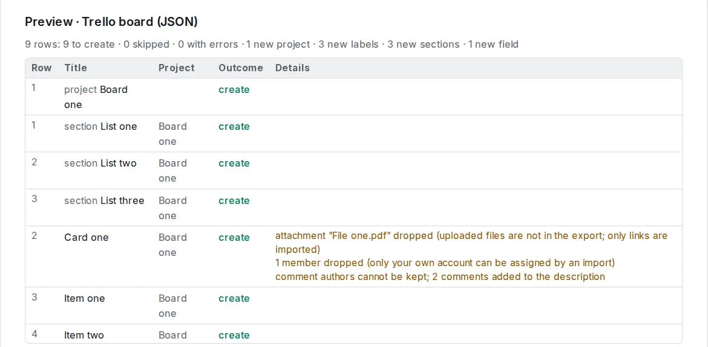

# Switch from Trello

Each board becomes a project that opens as a board, with the same lists as columns.

## Export from Trello

1. Open the board and its menu (**…**).
2. Choose **Print, export and share → Export as JSON**. Your browser saves or shows the file; save it as `board.json`.
3. Repeat for each board. You can put several board files in one ZIP and import them together.

## Import into OpenTodo

1. Open **Settings → Data → Import data** (or press `g` then `Shift+I`).
2. Choose the JSON file (or the ZIP). The preview shows **Trello board (JSON)**.
3. Check the warnings and select **Import**.

<picture><source srcset="../images/import-trello-dark.webp" media="(prefers-color-scheme: dark)"></picture>

## What carries over

- Lists become sections, in board order; archived lists come too, and their cards arrive completed.
- Card titles and descriptions, labels (named, or by colour when unnamed), due dates with their time, start dates.
- Cards marked complete or archived arrive completed.
- Checklists: each item becomes a subtask; checked items are completed.
- Comments are added to the description under "Comments", with who wrote them and when.
- Links attached to cards become link attachments.
- Cards you are a member of stay assigned to you.
- Custom fields (number, text, checkbox, date and dropdown) become [custom fields](../custom-fields.md) of the project.
- Each task remembers its card, with a link back to Trello.

The full mapping is in [Import formats](../import.md#trello-trello-json).

## What does not

- Uploaded files are not part of Trello's export; links to them are dropped with a warning. Download the files you need first.
- Other members are dropped with a warning; [share the project](../sharing.md) and assign them again.
- Power-Up data other than custom fields, stickers, cover images and votes.
