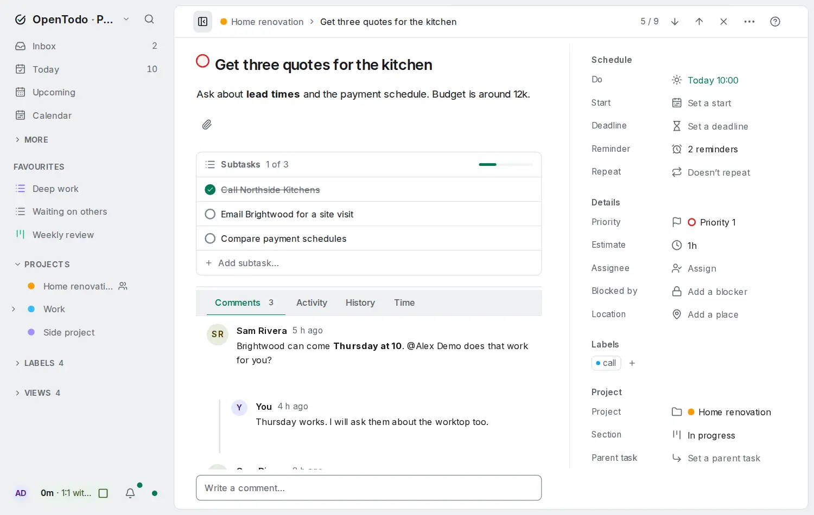
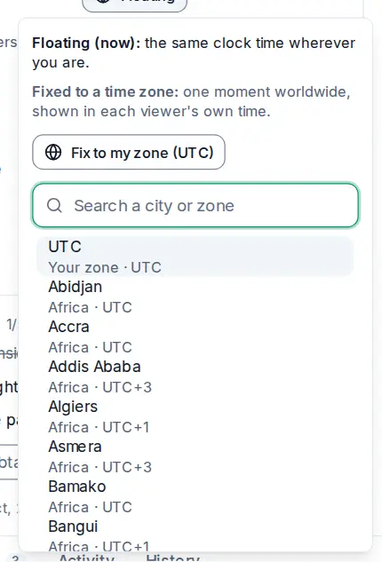
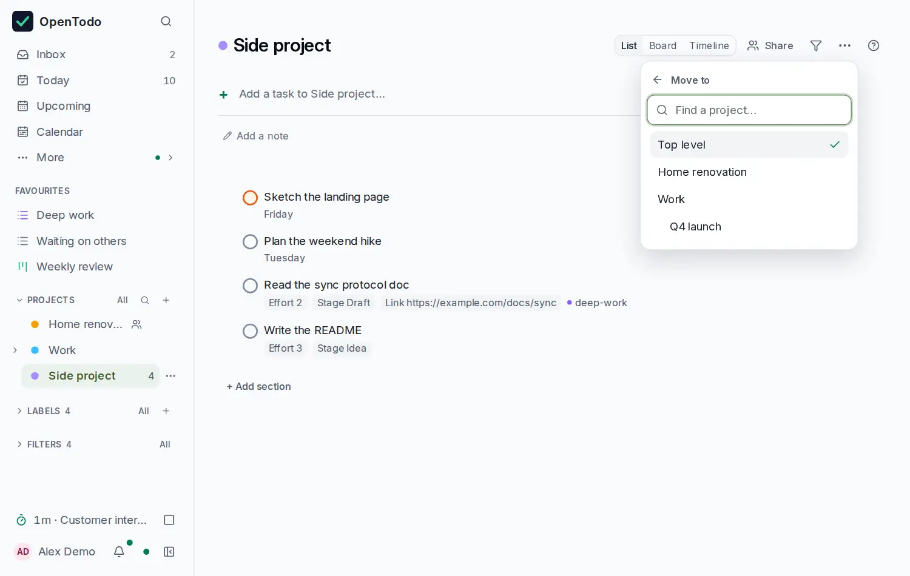

# Tasks and projects

A task is one thing to do. A project is a list of tasks that belong together. This guide covers both, from adding a task to arranging projects inside each other.

## Add a task

Press <kbd>q</kbd> anywhere in a task list, type, and press <kbd>Enter</kbd>. The box stays focused so you can add several in a row.

You can fill in details as you type:

```
Order new taps friday #Home @errand p2 +20m
```

This creates "Order new taps", due Friday, in the project Home, with the label errand, priority 2 and an estimate of 20 minutes. Chips under the box show what was understood before you press Enter. The [quick add reference](quick-add.md) has every word and symbol it knows.

New tasks without a project land in the **Inbox**. Tasks added inside a project go into that project, and tasks added in **Today** are due today.

## Edit a task

Click a task, or select it with <kbd>j</kbd> / <kbd>k</kbd> and press <kbd>Enter</kbd>, to open its panel. Every change is saved as you make it; there is no Save button.

<picture><source srcset="images/task-detail-dark.webp" media="(prefers-color-scheme: dark)"></picture>

The top of the panel has **Complete**, a **⋯** menu with **Copy link**, **Open parent task**, **Open recurring task** and **Delete**, and the **×** that closes it. Below are the **Title** and **Notes**. Notes can have headings, bold and italic text, links, and bullet, numbered and check lists.

Then comes the properties card. Each row shows its current value, or a quiet "No due date", "No estimate" and so on when it is empty. Click a row, or <kbd>Tab</kbd> to it and press <kbd>Enter</kbd>, to change it; <kbd>Esc</kbd> closes the editor and leaves you on the row.

- **Project**, **Section** and **Parent task** move the task. Each opens a list you can search: the projects and tasks you pick most often come first, and nested projects show their path ("Work › Clients"), so two projects with the same name are told apart. Type a new name in **Project** and choose **Create** to make a project and move the task into it. A subtask always shows its parent's section.
- **Assignee**. See [Assign tasks](sharing.md#assign-tasks).
- **Priority**, from P1 (most important) to P4 (the default). Click one, or press <kbd>1</kbd> to <kbd>4</kbd> anywhere in the panel outside a text field.
- **Due**, a date with an optional time, and the time zone chip next to it.
- **Reminders** show as chips. **Add reminder** offers the usual times before the due time, a custom offset or a set date and time; each chip's **⋯** menu edits, snoozes, dismisses or deletes it.
- **Estimate** and **Repeat**. See [Recurring tasks and reminders](recurring-and-reminders.md) and [Time blocking](time-blocking.md).
- **Labels**: open the row to add, create or remove labels.

Below the card are the **Subtasks** and the **Comments**, **Activity** and **History** tabs.

If you are a viewer of a shared project, the values read as text and can't be changed, and **Complete** and **Delete** are hidden. You can still comment.

Close the panel with <kbd>Esc</kbd> or the **×** at the top. On a phone the panel covers the list; close it to go back.

### Quick changes from the list

You don't have to open a task to change it. Select it and press:

| Key | Does |
| --- | --- |
| <kbd>1</kbd> to <kbd>4</kbd> | Set the priority |
| <kbd>c</kbd> | Complete or reopen |
| <kbd>L</kbd> | Add labels (type to search, <kbd>Enter</kbd> to add or create) |
| <kbd>e</kbd> | Set the estimate (`20`, `45m`, `1h30`) |
| <kbd>s</kbd> | Schedule it on the Day calendar |
| <kbd>Delete</kbd> | Move it to the Trash |

### Write notes

The notes field formats as you type. Start a line with `- ` for a bullet list, `1. ` for a numbered list, `[ ] ` for a checklist or `# ` for a heading. Select text and press <kbd>Ctrl</kbd>+<kbd>B</kbd> for bold or <kbd>Ctrl</kbd>+<kbd>K</kbd> for a link (<kbd>⌘</kbd> on a Mac). If two of your devices edit the same note at the same time, both sets of changes are kept.

### Dates and times

A due date is just a calendar day, and a time is the time on the clock where you are. A task due Tuesday at 09:00 shows Tuesday at 09:00 on every device, even when you travel.

Type the date and time in the **Due** fields, or pick them. Dates and times are shown in the format you chose in **Settings → Preferences → Date and time**, and you can type them the same way:

- **Date:** a date in your format (`14/10` or `10/14`, with or without a year), an ISO date (`2026-10-14`), or a word: `today`, `tomorrow`, a weekday such as `fri`, `next week` or `3 Nov`. A date without a year that has already passed this year means next year. Press <kbd>Enter</kbd> or leave the field to save it. If the date doesn't exist (`31/02`), the field says so and the task keeps its date.
- **Calendar:** the calendar button next to the date, or <kbd>Alt</kbd>+<kbd>↓</kbd> in the field, opens a month whose weeks start on your first day of the week. Arrow keys move by day and week, <kbd>Page Up</kbd> and <kbd>Page Down</kbd> by month, <kbd>Home</kbd> and <kbd>End</kbd> to the start and end of the week, <kbd>Enter</kbd> picks the day and <kbd>Esc</kbd> closes it.
- **Time:** `15`, `1530`, `15:30`, `3pm`, `3:30 pm` or `noon`, whichever clock you use. <kbd>↓</kbd> in the field shows times in 15-minute steps to pick from.

Clear the date to remove the due date, or clear the time to keep only the day.

Under the due date, the **time zone** button shows how the time is meant: **Floating** (the same clock time wherever you are) or a city and its offset, such as **New York · UTC−5** (one moment worldwide). Choose it to:

- **Fix to my zone:** tie the time to your current time zone, for things that happen at a fixed moment. Press <kbd>z</kbd> with the panel open to do the same, and again to release it.
- **Fix to another time zone:** search any city or zone, for example a call at 15:00 in New York. The panel shows how that reads for you ("15:00 in New York = 21:00 your time (Berlin)") before you choose **Fix to New York**. Your own zone is listed first, then the zones you used recently.
- **Make floating:** release a fixed time to the clock time you currently see.

<picture><source srcset="images/time-zone-dark.webp" media="(prefers-color-scheme: dark)"></picture>

Devices elsewhere show a fixed time converted to their local time, with the original time and city as a hint. Without a time the button is off: a due date alone always stays floating.

## Complete, reopen and delete

Click the circle next to a task, or press <kbd>c</kbd>. Completed tasks move to **Completed** in the sidebar, where you can reopen them.

Deleting a task (the **Delete** button in the panel, or <kbd>Delete</kbd> in the list) moves it to the Trash, along with its subtasks. You can restore it from there. See [Trash and history](trash-and-history.md).

## Break a task into subtasks

Big tasks are easier as a few small steps. To add one:

- open the task and type in **Add subtask**, or
- select the task in the list and press <kbd>a</kbd>.

Subtasks appear indented under their parent, and the parent shows your progress, like **1/3**. You can nest subtasks inside subtasks.

To turn an existing task into a subtask, select it and press <kbd>Tab</kbd>: it moves under the task above it. <kbd>Shift</kbd>+<kbd>Tab</kbd> moves it back out. You can also pick a **Parent task** in the panel. Use <kbd>←</kbd> and <kbd>→</kbd> to fold and unfold a parent's subtasks.

Completing a parent completes all its open subtasks too. When you tick off the last open subtask, OpenTodo asks whether to complete the parent as well; press <kbd>Enter</kbd> for yes.

## Organise with projects

Projects keep related tasks together. To create one, click **+** next to **Projects** in the sidebar, type a name and choose **Create**. Pick a parent project in the same form to make it a sub-project.

<picture><source srcset="images/project-list-dark.webp" media="(prefers-color-scheme: dark)"></picture>

The **Project** menu at the top right of a project lets you:

- pick a **colour** from the swatches at the top,
- **Move to…** another project, or back to the top level. Type to find the target: each candidate shows the projects it sits in, and the project itself and its sub-projects are never offered. <kbd>m</kbd> opens the menu straight at this step, and <kbd>Esc</kbd> goes back to the menu.
- **Rename** it,
- **Archive…** it, which hides it and its sub-projects from the sidebar while keeping every task,
- **Delete project…**, which moves it to the Trash.

Archive and delete ask first and say what they affect, for example how many open tasks and sub-projects move with the project.

<picture><source srcset="images/project-move-dark.webp" media="(prefers-color-scheme: dark)"></picture>

The number next to each project in the sidebar counts its open tasks. When a project with sub-projects is folded, the number includes them.

Inside a project you can also group tasks into sections and show them as a board. That has its own guide: [Sections and boards](sections-and-boards.md).

### Sub-projects

Sub-projects work like folders: "Work" can hold "Q4 launch", which can hold more. A project's page lists its sub-projects at the bottom with their task counts. Use the small arrow next to a project in the sidebar, or <kbd>←</kbd> / <kbd>→</kbd>, to fold and unfold it. Folding is remembered on each device separately.

### When a project is done

When you complete the last open task of a project, OpenTodo offers to archive it; press <kbd>Enter</kbd> to accept or any other key to keep it. Projects that have had no open tasks for 30 days are archived automatically, with a notice you can undo. You can turn that off in **Settings → Projects** (each device has its own setting). To bring an archived project back, open **Settings → Projects** and select **Restore** next to it under **Archived projects**; see [Trash and history](trash-and-history.md#bring-back-an-archived-project).

## Put things in order

In the Inbox and in projects, you decide the order. Drag a task to a new place (on a touch screen, press and hold first), or select it and press <kbd>Alt</kbd>+<kbd>↑</kbd> / <kbd>Alt</kbd>+<kbd>↓</kbd>. <kbd>Alt</kbd>+<kbd>Shift</kbd>+<kbd>↑</kbd> sends it to the top. Dropping a task on the middle of another one makes it a subtask. Projects in the sidebar can be reordered the same way.

Today, Upcoming, labels and filters sort themselves by date and priority, so dragging is switched off there.

## Tips

- Keep the Inbox as a landing spot: capture fast, then sort into projects once a day.
- Use priorities sparingly. If everything is P1, nothing is.
- A task with an estimate shows it on the row, like `30m`, which makes it easy to spot quick wins. The **Quick wins** button above most lists shows only tasks of 15 minutes or less.
