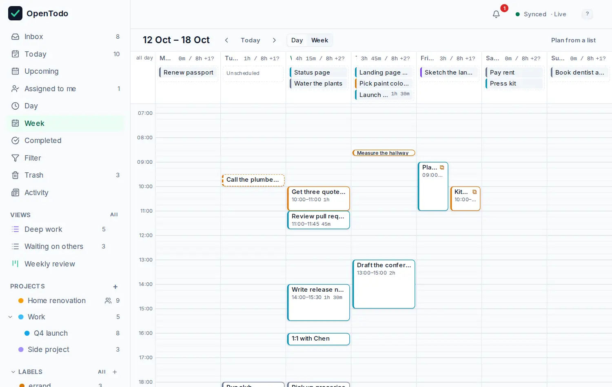
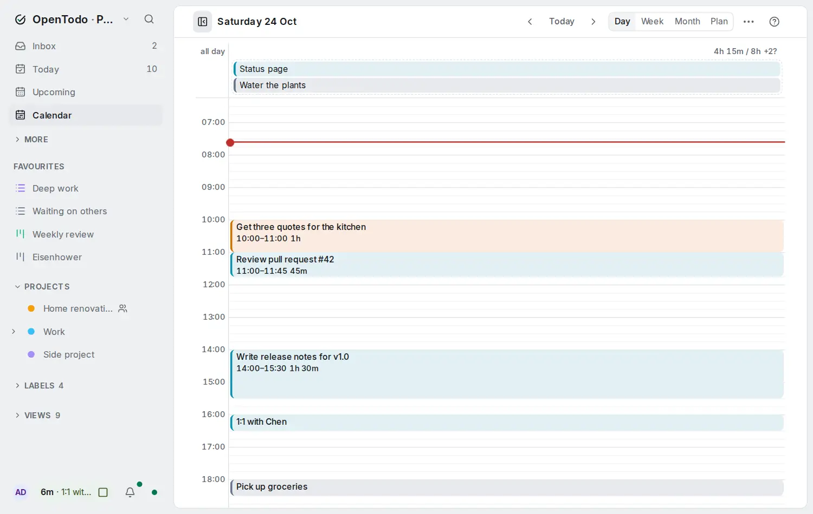

# Time blocking

A to-do list tells you what to do. A calendar tells you when. Time blocking puts the two together: give tasks an estimate, drop them on the Day or Week calendar, and you can see at a glance whether your day is realistic.

## Estimate how long a task takes

Select a task and press <kbd>e</kbd>, then type `20`, `45m`, `1h` or `1h30` and press <kbd>Enter</kbd>. In the task panel, **Estimate** also has buttons for 15 minutes up to 2 hours. In quick add, write `+30m` or `+1h30`.

The estimate shows on the task row, like `45m` or `1h 30m`.

## Open the calendar

Choose **Calendar** in the sidebar, then **Day**, **Week** or **Month** in its header, or press <kbd>g</kbd> <kbd>d</kbd>, <kbd>g</kbd> <kbd>w</kbd> or <kbd>g</kbd> <kbd>m</kbd>. The sidebar opens the calendar the way you last left it on this device.

<picture><source srcset="images/week-dark.webp" media="(prefers-color-scheme: dark)"></picture>

- Tasks with a date **and** a time appear as blocks at that time. The block is as tall as the estimate.
- A timed task without an estimate gets a 30-minute block with a dashed outline.
- Tasks with a date but no time wait in the **Unscheduled** lane at the top of their day.
- A red line marks the current time.

Use **‹** and **›** (or <kbd>[</kbd> and <kbd>]</kbd>) to go back and forward, and **Today** (or <kbd>t</kbd>) to come back.

The Week view starts on your first day of the week, and the hours and block times follow your time format (`9 AM` or `09:00`). Both are set in **Settings → General → Date and time** and follow you to all your devices. Moving a block still sets the same time; only how it is shown changes.

## See the month

**Month** shows six weeks at a glance, starting on your first day of the week, with today marked and the days of other months dimmed. Each day lists its open tasks: the timed ones first by time, then the rest by priority. A crowded day shows the first few and **+N more**, which expands the day in place. When a day's tasks have estimates, the day shows the planned total against your day length, in red when it is over.

- Drag a task onto another day to move it. It keeps its time.
- Select a task with <kbd>j</kbd> and <kbd>k</kbd>, or by clicking it. The arrows then move it a day (<kbd>←</kbd> <kbd>→</kbd>) or a week (<kbd>↑</kbd> <kbd>↓</kbd>), into the next month if needed. <kbd>Enter</kbd> opens it, and <kbd>Esc</kbd> clears the selection.
- With no task selected, the arrows move between days. <kbd>q</kbd> adds a task due on the day you're on.
- <kbd>[</kbd> and <kbd>]</kbd> go to the previous and next month, and <kbd>t</kbd> comes back to today.

Switching between **Day**, **Week** and **Month** keeps the date you're looking at. On a phone, each day shows how many tasks it has, and the tasks of the day you tap are listed under the month. Tasks in a project where you're a viewer are shown but can't be moved. Like the rest of the calendar, the month works offline.

## Plan a project on a timeline

For work that spans weeks, such as a move, a launch or a trip, switch the project to **Timeline**. Each task is a bar from its start to its deadline, so overlaps and gaps are easy to see, and you can drag bars to reschedule. See [See a project on a timeline](sections-and-boards.md#see-a-project-on-a-timeline).

## Place a task on the calendar

Drag a task from the Unscheduled lane onto a time slot. Its due date and time become that slot. The grid works in 15-minute steps.

To plan from your lists, open the side list with **Plan from a list** and drag tasks from there onto the calendar.

To change how long something takes, drag the bottom edge of its block. Dropping a block back on the Unscheduled lane keeps the date and removes the time.

### With the keyboard

Every move works without a mouse.

1. In Today, a project or any list, select a task and press <kbd>s</kbd>. The Day view opens with the task ready to place.
2. Move it with the arrow keys: <kbd>↑</kbd> / <kbd>↓</kbd> by 15 minutes, <kbd>←</kbd> / <kbd>→</kbd> by a day.
3. Press <kbd>Enter</kbd> to place it, or <kbd>Esc</kbd> to cancel.

On the calendar itself, <kbd>j</kbd> / <kbd>k</kbd> select tasks, the arrows move the selected one, <kbd>Shift</kbd>+<kbd>↑</kbd> / <kbd>Shift</kbd>+<kbd>↓</kbd> shorten or lengthen it, and <kbd>u</kbd> takes it off the grid while keeping its date.

## See whether the day fits

Each day's header adds up the estimates of its open tasks and compares them with your day length, for example `4h 15m / 8h`. When you've planned more than the day holds, the header is marked as over capacity. That's your cue to move something.

Tasks that overlap in time are shown side by side, with a marker, so nothing hides behind something else.

Completing a task removes its block and lowers the day's total.

<picture><source srcset="images/day-dark.webp" media="(prefers-color-scheme: dark)"></picture>

## See your other calendars

When the server owner has turned on [calendar feeds](calendar-feeds.md), you can subscribe to your Google, Outlook or Apple calendars under **Settings → Integrations → Calendar feeds**. Their events then appear in Day and Week: timed events as blocks in the calendar's colour beside your tasks, and all-day events as chips above the unscheduled lane. An event that overlaps a task gets the same overlap marker, so you can see a clash at a glance. Events never count toward the day's total.

Events are read-only. You can't drag, resize or complete them, but you can tab onto one and press Enter to read its time, location and calendar. The **Calendars** button in the toolbar hides them on this device. Offline, the calendar shows the events from the last refresh.

## Adjust the grid

On a phone the Week is a list: each day with its unscheduled tasks and its timed tasks in order, so nothing is squeezed into seven columns. Tap a task to select it, tap again (or press Enter) to open it.

In **Settings → General → Calendar** you can set when the grid starts and ends (6:00 to 22:00 by default; you can still scroll beyond) and how long your working day is (8 hours by default). These settings belong to each device, so your phone and laptop can differ.

## Tips

- Estimate generously at first. After a week you'll know how long "quick" things really take.
- Leave gaps. A day planned to the minute falls apart at the first phone call.
- **Quick wins**, under the **Filter** action in a list's header, shows tasks of 15 minutes or less, good for filling a short gap.
- Dates and times you set on the calendar are ordinary due dates, so they show up in Today and Upcoming as well, and in calendar apps connected over [CalDAV](caldav.md).
