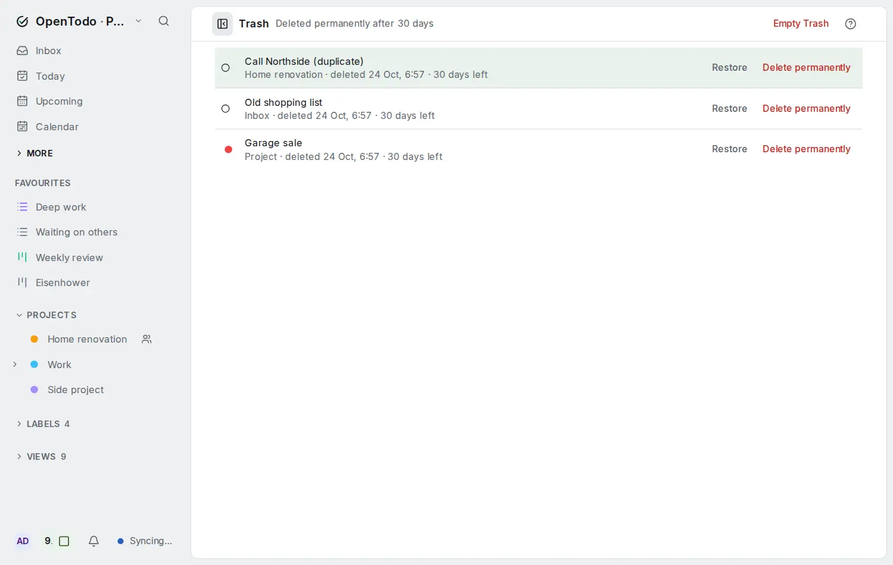
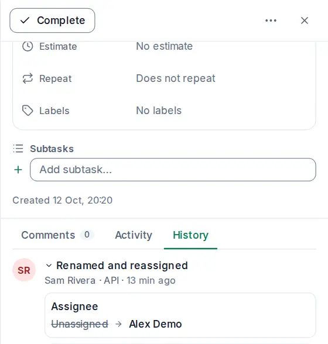
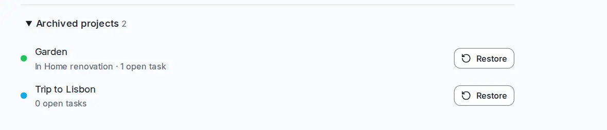

# Trash and history

Deleting something in OpenTodo doesn't make it vanish. It goes to the Trash first, and every change to a task is kept in its history, so a slip of the finger is easy to undo.

## Restore something from the Trash

Open **Trash** in the sidebar (or press <kbd>g</kbd> <kbd>x</kbd>). It lists deleted tasks and projects, newest first, with when they were deleted and how many days they have left.

<picture><source srcset="images/trash-dark.webp" media="(prefers-color-scheme: dark)"></picture>

Select **Restore** next to an item. It comes back exactly where it was:

- A restored project returns to its place in the sidebar, with all its tasks.
- A restored task returns to its project. If that project is still in the Trash, the task goes to your Inbox instead.

With the keyboard: <kbd>j</kbd> / <kbd>k</kbd> to select, <kbd>r</kbd> to restore.

## Delete for good

**Delete permanently** removes one item for good, and **Empty Trash** removes everything in it. Both ask you to confirm, and both need a connection. Once something is permanently deleted, it's gone from every device and from the server, and it can't come back.

Items are also deleted for good automatically after 30 days in the Trash. Your server's owner can change that period or turn it off.

## What deleting does

- Deleting a task also deletes its subtasks.
- Deleting a project hides it and its tasks everywhere. Its sub-projects move up a level, so they aren't lost.
- Reminders on deleted tasks stay quiet. Restore the task and they work again.
- Deleted items are still in your [export](import-export.md#download-everything) until they are deleted for good.

## See what changed on a task

Open a task and select the **History** tab below its details. Changes are grouped into versions, newest first: everything one person changed from one device within a few minutes is one version, with a one-line summary such as "Renamed and rescheduled", who made it, where (this device, another device, the API, a calendar app, or an AI assistant) and when. Select a version to see each change: the old value struck through and the new one next to it, shown the way the task shows them (dates in your date format, priorities, labels, project and section names). A change marked **not applied** arrived after a newer one and never took effect; you can still restore it. Changes made by an [AI assistant](mcp.md#letting-an-assistant-make-changes) read "AI assistant (*token name*)" for your own assistants and "AI assistant" for someone else's in a shared project, and can be restored like any other change.

<picture><source srcset="images/history-dark.webp" media="(prefers-color-scheme: dark)"></picture>

Projects have a **History** too, at the top of the project.

History is loaded from your server, so it needs a connection. Offline, the tab says so instead of showing anything out of date.

## Bring back an earlier value

Next to each change in a version is **Restore this value**. Select it to set the field back to that value. To put back everything a version changed at once, select **Restore this version**; a confirmation lists the fields first. Restoring is a change like any other: it syncs to all devices and shows up in the history itself as a new version, so you can always undo the undo. Each field is restored as its own change, so if someone edits the same field on another device at the same time, the later edit wins for that field.

## Activity on a task

The **Activity** tab of a task shows who created it, completed it, moved it or changed the date, newest first. Quick changes by one person within ten minutes are grouped into one line, such as "You changed the due date and priority"; select it to see each change. Comments appear as one short line that opens the comment. Activity works offline; your changes that are not synced yet are marked pending. In shared projects this includes everyone's changes. See [Sharing and comments](sharing.md#see-what-others-changed).

## Archived projects

Archiving is different from deleting. An archived project disappears from the sidebar, but it isn't in the Trash and isn't deleted after 30 days: it and its tasks are kept as they are. Archive a project from its **Project** menu.

When you complete the last task of a project, OpenTodo offers to archive it. Projects without open tasks for 30 days are archived automatically, with a notice that has an undo button. To switch automatic archiving off on a device, untick the option under **Settings → Projects**.

### Bring back an archived project

Open **Settings → Projects**. Under **Archived projects** you see every archived project, with its parent project and how many open tasks it has. Select **Restore** next to one, and it's back in the sidebar with all its tasks. With the keyboard, <kbd>Tab</kbd> to the button and press <kbd>Enter</kbd>.

<picture><source srcset="images/archived-projects-dark.webp" media="(prefers-color-scheme: dark)"></picture>

- Restoring works offline, like any change, and the project comes back on your other devices after they sync.
- Restoring brings back that one project. If you archived a project with sub-projects, they stay in the list until you restore each of them.
- A project you restore by hand isn't archived automatically again on that device.
- In a shared project, only the owner or an admin can restore it, the same people who can archive it.
