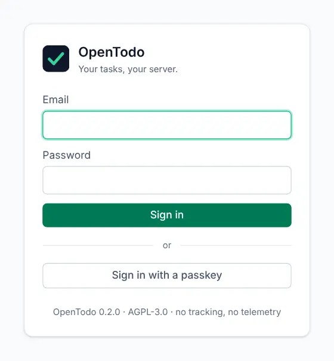

# Sync, sign-in and sharing problems

<picture><source srcset="images/signin-dark.webp" media="(prefers-color-scheme: dark)"></picture>

These are the problems that involve your server: a task that isn't where you expect it, changes that stay on one device, an account you can't get into, and shared projects. The shorter list is in [Troubleshooting and FAQ](troubleshooting.md).

## A task seems to be missing

Check these places, in this order:

1. **A duration filter.** If **Quick wins**, **Under 30 min**, **Over 1 h** or **Unestimated** is on, a chip with that name sits in the list's header and the list shows only matching tasks. Clear it with the chip's × or from the **Filter** action.
2. **Completed.** It may have been ticked off by accident. Open **Completed** and reopen it.
3. **Trash.** It may have been deleted, or its project was. See [Trash and history](trash-and-history.md).
4. **An archived project.** Tasks of archived projects don't appear in Today or Upcoming.
5. **A folded parent or section.** Select the small arrow to unfold it.
6. **A shared project you left** or were removed from. Ask its owner.

The **New view** page with `search: word` (add `& completed` to include finished tasks) searches titles and notes.

## Changes don't show up on my other device

- Look at the status at the top right of both devices. **Offline · 3 pending** means the changes are still waiting on that device; they're sent as soon as it's online.
- Click the status to sync right away.
- **Sync error**: hover over it to see the reason. If the server is down or being updated, it clears up once the server is back.
- **Signed out**: your session ended. Sign in again; waiting changes are sent afterwards.
- **Locked**: your account uses [encryption](e2ee.md). Enter your passphrase on that device.

See [Offline and sync](offline-and-sync.md) for what each status means.

## I can't sign in

- Check the email address and that Caps Lock is off. Passwords are at least 10 characters.
- After several failed attempts, the server makes you wait a little before trying again.
- **Forgot your password?** OpenTodo doesn't send reset emails. Ask the owner or an admin of your server for a reset link. If you are the owner, see [recovering owner access](self-hosting/docker.md#recovering-owner-access).
- **Lost your two-factor phone?** Use one of your recovery codes instead of the code. Without them, the server owner can reset your two-factor authentication.

## The demo says my sandbox expired

Demo sandboxes are deleted after two hours without activity, after 24 hours at most, and every night. Select **Start a new sandbox** to get a fresh one. Nothing from the old sandbox is kept.

## I can't edit a shared project

Your role in that project is **viewer**, which is read-only. Ask the owner or an admin to make you an editor. See [Sharing and comments](sharing.md#choose-a-role).

## I can't share a project with someone

You can only add people who have an account on your server. Ask an admin of the server to [invite them](sharing.md#invite-someone-new) first. Accounts with end-to-end encryption turned on can't share new projects.
