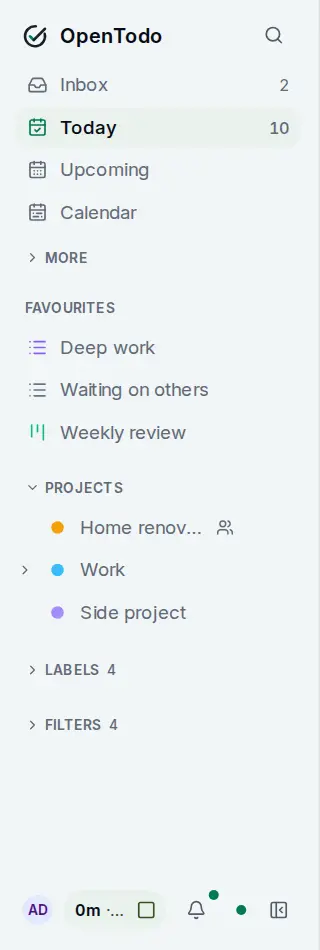

# Views

<picture><source srcset="images/sidebar-dark.webp" media="(prefers-color-scheme: dark)"></picture>

A view is a way of looking at your tasks. OpenTodo comes with a handful, and you can save your own. Every view is built from the copy of your tasks on your device, so they all work offline and update the moment something changes.

## The built-in views

Inbox, Today, Upcoming, Anytime, Someday, Assigned to me, Calendar, Completed, Filter, Trash and Updates are at the top of the sidebar, the less frequent ones under **More**. Each has a shortcut: press <kbd>g</kbd>, then a letter, for example <kbd>g</kbd> <kbd>i</kbd> for the Inbox. A project can also be shown as a list, a board or a timeline. [The built-in views](built-in-views.md) says what each one shows, with its shortcut.

## Process the Inbox

When the Inbox has piled up, **Process** in its header (or <kbd>g</kbd> <kbd>p</kbd>) shows one task at a time with a key for each decision: today, schedule, move, delegate, label, Someday, complete or trash, each with Undo. See [Process the Inbox](process-the-inbox.md).

## Plan your day with Today

Today lists overdue tasks first, in red, then today's tasks by time, with **This Evening** and **Blocked** groups below. A task whose deadline or start date has come shows up here too. Anything you add here is due today. See [Today and Upcoming](today-and-upcoming.md#plan-your-day-with-today).

## Plan your week with Upcoming

Upcoming groups everything due after today by day, from **Tomorrow** on, and lists a task with a deadline on its deadline day: a good place for a short weekly review. See [Today and Upcoming](today-and-upcoming.md#plan-your-week-with-upcoming).

## Anytime, for when you have time

Anytime lists the open tasks with no due date, no deadline and no start date, grouped by project. See [Anytime](built-in-views.md#anytime-for-when-you-have-time).

## Park ideas in Someday

Someday holds the tasks you parked with <kbd>n</kbd>. They stay out of Today, Upcoming, Anytime and the counts. See [Someday](built-in-views.md#park-ideas-in-someday).

## Narrow a list by duration

The **Filter** action in a list's header shows only quick wins, tasks under 30 minutes, tasks over an hour or tasks without an estimate. See [Narrow a list by duration](built-in-views.md#narrow-a-list-by-duration).

## Save your own views

Describe what you want in the **Filter** view, press <kbd>s</kbd> and name it. The saved view is pinned to the sidebar with a live count and syncs to all your devices. See [Saved views](saved-views.md#save-your-own-views).

## Build a dashboard

A dashboard puts up to six saved views side by side, for a morning review on one screen. See [Build a dashboard](saved-views.md#build-a-dashboard).

## Choose where the app opens

Each device can open on a different view: your laptop on a "Work" view, your phone on Today. Pick it in **Settings → General → Start view**, or from a saved view's menu with **Start view on this device**. If that view is deleted later, the device opens on the Inbox and tells you why.

## Tips

- Subtasks show up on their own in Today and Upcoming, with their parent's name next to them, so you see exactly what's due.
- Views that sort by date (Today, Upcoming, labels, filters) can't be reordered by hand. Projects and the Inbox can.
- [Filter queries](filters.md) has ten ready-made examples to copy.
