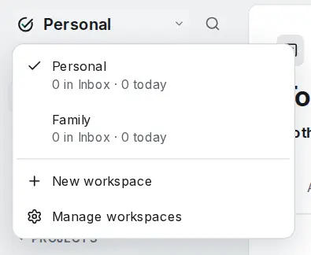
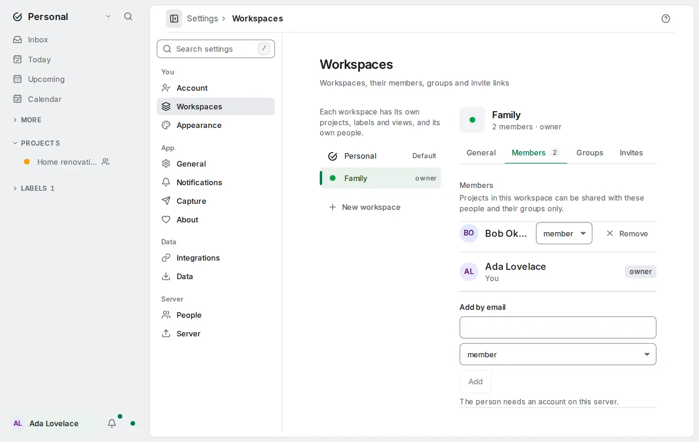

# Workspaces

<picture><source srcset="images/workspace-switcher-dark.webp" media="(prefers-color-scheme: dark)"></picture>

A workspace is a separate room with its own projects, labels, filters and people. Keep your job in **Work** and the household in **Family**, and switch between them in one click.

## Your default workspace

Every account starts with one workspace, **Personal**, which holds everything you had before. With a single workspace the top of the sidebar reads **OpenTodo · Personal**, and nothing else changes.

## Switch

Select the workspace name at the top of the sidebar to open the switcher. It lists your workspaces with their Inbox and Today counts. Pick one and every list, count, search and quick add shows that workspace. A dot on the name means another workspace has updates.

Your choice is remembered on each device. From the keyboard, open search with <kbd>Ctrl</kbd>+<kbd>K</kbd> and type **Switch to workspace**. Opening a link or a notification from another workspace switches for you.

## Create a workspace

Choose **New workspace** in the switcher, name it and pick a colour. It needs a connection to your server. New projects, labels and filters, and tasks you add to the Inbox, go into the workspace you are in.

## Members and groups

Open **Settings → Workspaces** to add people by the email of their account on this server, give them the **member** or **admin** role, and make groups such as **Adults**. You can also create an invite link that adds whoever opens it.

<picture><source srcset="images/settings-workspaces-dark.webp" media="(prefers-color-scheme: dark)"></picture>

Projects stay private until you share them. In a workspace you created, the Share dialog lists its members by name and its groups: share **House** with **Adults** as editor and everyone in the group can edit it. Someone outside the workspace cannot be added to its projects. In your default workspace you share by email, as before.

## Move things

The project menu has **Move to workspace…** for projects you own. Its tasks, sections and sub-projects follow, and labels on its tasks are matched by name in the other workspace. Undo puts everything back. A task in the Inbox moves with the command **Move … to workspace** in search.

## Good to know

- Preferences such as the theme and language are per account, not per workspace.
- With [end-to-end encryption](e2ee.md) you can create workspaces and move things, but not add members, groups or invite links yet.
- An account owns at most 20 workspaces; a workspace has up to 200 members and 50 groups.
- Sharing works as described in [Sharing and comments](sharing.md); labels and filters belong to one workspace each ([Labels and filters](labels-and-filters.md)).
